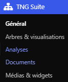
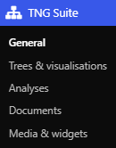

# TNG Suite

**Français** · [English below](#english)

Extension WordPress qui affiche vos données [TNG](https://tngsitebuilding.com/) (The Next Generation of Genealogy Sitebuilding) : arbres et descendance, frise chronologique, carte de chaleur des lieux, galerie de médias, statistiques, éventail, implexe et consanguinité, individu au hasard, nuage de noms, un **contrôle de cohérence des données** (administrateurs, lecture seule) et un **livre généalogique** (page imprimable, PDF, Word, OpenDocument).

Licence : GPLv2 ou ultérieure. Prérequis : WordPress 5.8+, PHP 7.4+ (code contrôlé de PHP 7.4 à 8.5 ; compatibilité WordPress vérifiée jusqu’à la 7.1). Interface et textes publics en français et en anglais.

## Présentation et documentation

- **[Guide des modules en français](docs/fr/README.md)** : une page par module, avec ses réglages et des captures d'écran
- **[Guide d'utilisation complet (texte)](LISEZ-MOI.txt)** : installation, réglages communs, vivants / privés, modèles du livre…
- [Journal des changements](readme.txt) (rubrique « Changelog »)

| Famille (menu **TNG Suite**) | Modules |
|---|---|
| Arbres & visualisations | [Arbres & descendance](docs/fr/trees.md), [Bouton vers la fiche](docs/fr/link.md), [Frise chronologique](docs/fr/timeline.md), [Éventail / roue de parenté](docs/fr/fan.md) |
| Stats & analyses | [Statistiques & graphiques](docs/fr/stats.md), [Heatmap des lieux](docs/fr/heatmap.md), [Implexe & consanguinité](docs/fr/implexe.md), [Cohérence des données](docs/fr/coherence.md) |
| Documents | [Livre généalogique](docs/fr/book.md), [Fiche & listes de documents](docs/fr/fiche.md), [Liste flash des patronymes](docs/fr/flash.md) |
| Médias & widgets | [Galerie de médias](docs/fr/gallery.md), [Nuage de noms & anniversaires](docs/fr/extra.md), [Individu au hasard](docs/fr/random.md) |

Les réglages communs (connexion à la base TNG, préfixe, adresse de TNG, vivants / privés, activation des modules) sont dans [Général](docs/fr/general.md).



## Installation

1. Téléchargez `tng-suite.zip` dans la dernière [Release](../../releases/latest) (et non « Source code (zip) » : le zip de la Release contient le PDF direct et les bibliothèques).
2. Dans WordPress : Extensions → Ajouter → Téléverser une extension.
3. Réglez la connexion à la base TNG dans **TNG Suite → Général**.

## Confidentialité et sécurité

- Les **personnes vivantes et privées sont masquées par défaut** (réglage commun dans Général, modifiable module par module).
- Le plugin ne fait que **lire** votre base TNG : utilisez un compte MySQL en lecture seule. Le mot de passe, s'il est saisi dans le plugin, est chiffré ; avec `wp-config.php`, rien n'est stocké.
- Aucun cookie ni statistique de visite ; rien n'est envoyé à l'auteur. Services tiers possibles (CDN de bibliothèques, tuiles de carte, GitHub pour les mises à jour) : voir la rubrique « External services » de [readme.txt](readme.txt).
- Le contrôle de cohérence des données est **réservé aux administrateurs** et en **lecture seule** sur la base TNG ; ses résultats (qui peuvent citer des personnes vivantes) sont stockés dans la base WordPress et supprimés à la désinstallation.
- Signaler une faille de sécurité : ouvrez une [alerte de sécurité privée](../../security/advisories/new) sur ce dépôt plutôt qu'un ticket public.

## Mises à jour automatiques

Elles fonctionnent d'office : WordPress affiche « mise à jour disponible » dès qu'une nouvelle Release est publiée sur ce dépôt (public). Rien à ajouter dans `wp-config.php`.

Le réglage ci-dessous ne sert que dans trois cas : suivre **un fork**, utiliser **un dépôt privé**, ou **désactiver** la vérification. Dans `wp-config.php`, avant la ligne « That's all, stop editing » :

```php
define( 'TNGSUITE_GITHUB_REPO', 'https://github.com/VOTRE-COMPTE/Tng-Suite/' );   // un fork
define( 'TNGSUITE_GITHUB_REPO', '' );                                             // désactiver
```

## Publier une version (mainteneur)

1. Mettre à jour le numéro de version dans `tng-suite.php` (en-tête et `TNGSUITE_VERSION`) et dans `readme.txt` (`Stable tag`, changelog).
2. Pousser sur `main`, puis créer une **Release** sur GitHub avec l'étiquette `vX.Y.Z` (par exemple `v3.0.0`), sans « pre-release » pour une version stable.
3. L'action GitHub (`.github/workflows/release.yml`) construit `tng-suite.zip` (avec mPDF et les bibliothèques JavaScript) et l'ajoute à la Release.

## Notes

- Le nom « TNG » désigne un logiciel tiers ; ce projet n'est pas affilié à son auteur.
- Bibliothèques tierces : voir `libs/LISEZ-MOI.txt`. Le moteur PDF mPDF (GPL-2.0-only) est fourni dans `modules/book/vendor/` avec ses licences.

---

## English

WordPress plugin that displays your [TNG](https://tngsitebuilding.com/) (The Next Generation of Genealogy Sitebuilding) data: trees and descendants, timeline, places heatmap, media gallery, statistics, fan chart, pedigree collapse (implex) and inbreeding coefficient, random individual, name cloud, a **data consistency check** (administrators, read-only) and a **genealogy book** (printable page, PDF, Word, OpenDocument).

License: GPLv2 or later. Requirements: WordPress 5.8+, PHP 7.4+ (code checked from PHP 7.4 to 8.5; WordPress compatibility checked up to 7.1). Admin screens and public texts in French and English.

### Overview and documentation

- **[Module guide in English](docs/en/README.md)**: one page per module, with its settings and screenshots
- **[Full user guide (text)](USER-GUIDE.txt)**: installation, shared settings, living / private people, book templates…
- [Changelog](readme.txt) (“Changelog” section)

| Family (**TNG Suite** menu) | Modules |
|---|---|
| Trees & visualisations | [Trees & descendants](docs/en/trees.md), [Record link button](docs/en/link.md), [Timeline](docs/en/timeline.md), [Fan / kinship wheel](docs/en/fan.md) |
| Stats & analyses | [Statistics & charts](docs/en/stats.md), [Places heatmap](docs/en/heatmap.md), [Implex & inbreeding](docs/en/implexe.md), [Data consistency](docs/en/coherence.md) |
| Documents | [Family book](docs/en/book.md), [Individual sheet & document lists](docs/en/fiche.md), [Surname flash list](docs/en/flash.md) |
| Media & widgets | [Media gallery](docs/en/gallery.md), [Name cloud & birthdays](docs/en/extra.md), [Random individual](docs/en/random.md) |

Shared settings (TNG database connection, table prefix, TNG URL, living / private people, module activation) are in [General](docs/en/general.md).



### Installation

1. Download `tng-suite.zip` from the latest [Release](../../releases/latest) (not “Source code (zip)”: the Release zip includes direct PDF output and the libraries).
2. In WordPress: Plugins → Add New → Upload Plugin.
3. Set the TNG database connection in **TNG Suite → General**.

### Privacy and security

- **Living and private people are hidden by default** (shared setting in General, adjustable per module).
- The plugin only **reads** your TNG database: use a read-only MySQL account. A password entered in the plugin is encrypted; with `wp-config.php`, nothing is stored.
- No cookie and no visit statistics; nothing is sent to the author. Possible third-party services (library CDNs, map tiles, GitHub for updates): see the “External services” section of [readme.txt](readme.txt).
- The data consistency check is **reserved for administrators** and **read-only** on the TNG database; its results (which may name living people) are stored in the WordPress database and deleted on uninstall.
- To report a security issue, open a [private security advisory](../../security/advisories/new) on this repository rather than a public issue.

### Automatic updates

They work out of the box: WordPress shows “update available” as soon as a new Release is published on this (public) repository. Nothing to add to `wp-config.php`.

The setting below is only needed to follow **a fork**, use **a private repository**, or **turn the check off**:

```php
define( 'TNGSUITE_GITHUB_REPO', 'https://github.com/YOUR-ACCOUNT/Tng-Suite/' );   // a fork
define( 'TNGSUITE_GITHUB_REPO', '' );                                             // turn off
```

### Notes

- “TNG” is the name of third-party software; this project is not affiliated with its author.
- Third-party libraries: see `libs/LISEZ-MOI.txt`. The mPDF PDF engine (GPL-2.0-only) is bundled in `modules/book/vendor/` with its licences.
