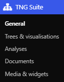

# TNG Suite – Module guide

This guide presents each module: where to set it up, how to use it and what it looks like. French: [Guide français](../fr/README.md).

The **TNG Suite** menu has five entries: **General** and four families. Each former admin page is a section of its family (section bar at the top of the page):

| Menu entry | Contains |
|---|---|
| General | connection, shared settings, modules, maintenance |
| Trees & visualisations | Trees & descendants, Record link button, Timeline, Fan / kinship wheel |
| Analyses | Statistics & charts, Places heatmap, Implex & inbreeding |
| Documents | Family book, Individual sheet & document lists |
| Media & widgets | Media gallery, Name cloud & birthdays, Random individual |

“Record link button” is switched on with “Trees & descendants”, and “Random individual” with “Name cloud & birthdays” (one activation box and one “Living / private” setting for each pair); their shortcodes are unchanged.

- [General](general.md)
- **Trees & visualisations**
  - [Trees & descendants](trees.md)
  - [Record link button](link.md)
  - [Timeline](timeline.md)
  - [Fan / kinship wheel](fan.md)
- **Analyses**
  - [Statistics & charts](stats.md)
  - [Places heatmap](heatmap.md)
  - [Implex & inbreeding](implexe.md)
- **Documents**
  - [Family book](book.md)
  - [Individual sheet & document lists](fiche.md)
- **Media & widgets**
  - [Media gallery](gallery.md)
  - [Name cloud & birthdays](extra.md)
  - [Random individual](random.md)
