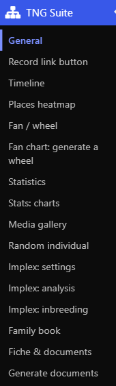

# TNG Suite – Module guide

This guide presents each module: where to set it up, how to use it and what it looks like. French: [Guide français](../fr/README.md).

- [General](general.md)
- [Trees & descendants](trees.md)
- [Record link button](link.md)
- [Timeline](timeline.md)
- [Places heatmap](heatmap.md)
- [Fan / kinship wheel](fan.md)
- [Statistics & charts](stats.md)
- [Media gallery](gallery.md)
- [Random individual](random.md)
- [Name cloud & birthdays](extra.md)
- [Implex & inbreeding](implexe.md)
- [Family book](book.md)
- [Individual sheet & document lists](fiche.md)
