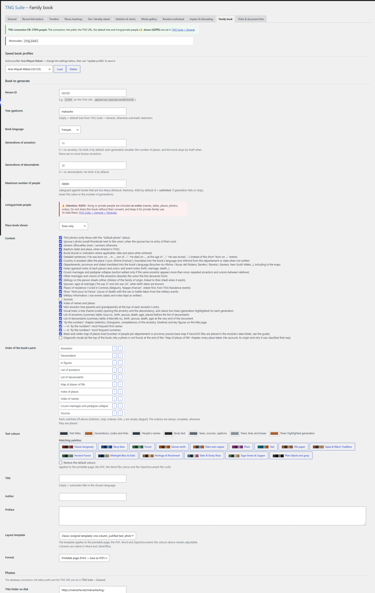

# Family book

Generates a complete book (ancestry, descendants, indexes, maps, statistics) as a printable page/PDF, Word (.docx) or OpenDocument (.odt), in French, English, Spanish or Catalan.

## In the admin



## Shortcodes

```
[tng_book]
```

## How to use

The page has three tabs: **Generate a book**, **Settings** and **Overview of profiles**. When profiles exist, the “Generate a book” tab first shows only the profile picker: load a profile or click **New book** to display the form (with no profile, the form is shown directly). Photos, the public form and the automatic generation settings are in the **Settings** tab.

1. Enter the person ID, the tree and the number of generations.
2. Tick the wanted content, order the parts, pick colours and a layout template.
3. Choose the format and generate. A profile can be saved and reloaded.

## Result on the site


## Notes

- Surname page: an editor (formatting, tables, images) lets you write an introduction to the surname; it is saved in the book profile and placed with “Order of the book’s parts”. Empty = no page. Images aligned left or right in the editor keep their place, with the text wrapping around them, in the PDF, Word and OpenDocument outputs.
- Silhouettes: for people without a photo, “Style of generic silhouettes” lets you choose between the portrait (circle on a light background) and the round version (no background).
- Family chronology: tick-box option (off by default); adds a part listing the births, marriages and deaths of the people in the book in date order, grouped by decade (with a link to each record, the place and the age at death). Hidden (living) people are left out. It is placed with “Order of the book’s parts” like any other part.
- Each part starts on a new page.
- The [tng_book] shortcode opens the generator to logged-in visitors if enabled.
- Living people are fully included if you choose to show them: do not share the book without consent.

## Automatic generation (beta)

Each profile can be generated automatically, every day, week or month, with no action on your part.

1. Load (or create) a book profile. Its format (PDF, Word, OpenDocument or HTML) is the one used.
2. In the **Automatic generation for this profile** section of the form, tick **Generate automatically**, then choose the frequency, day and time.
3. Click **Update the active profile** (or **Save as profile**): the schedule is saved with the profile.
4. The **Overview of profiles** tab shows all profiles (schedule, last generation, latest file, **Generate now** button to test and **Edit** button to load the profile). The **Settings** tab holds the shared settings: **destination folder** (absolute path on the server; empty = protected, randomly named folder inside WordPress uploads; to sync with OneDrive, Dropbox, etc., choose a folder your sync tool watches), number of files kept per profile (older ones are deleted; only files created by the plugin are affected), the **Only if the data has changed** option and the notification email.

Notes:

- WordPress only runs its tasks when the site is visited, so the time is approximate. For an exact time, set up a server cron job that calls `wp-cron.php` (for example every hour).
- Direct PDF uses mPDF, already included in the GitHub Releases zip. If the plugin is installed from source, run `composer install --no-dev` in `modules/book`; without mPDF, generating a PDF profile fails (message in the “Last generation” column).
- Photos or notes changed without any change to the records are not detected by “only if the data has changed”: use **Generate now**.

---
[← Module guide](README.md)
