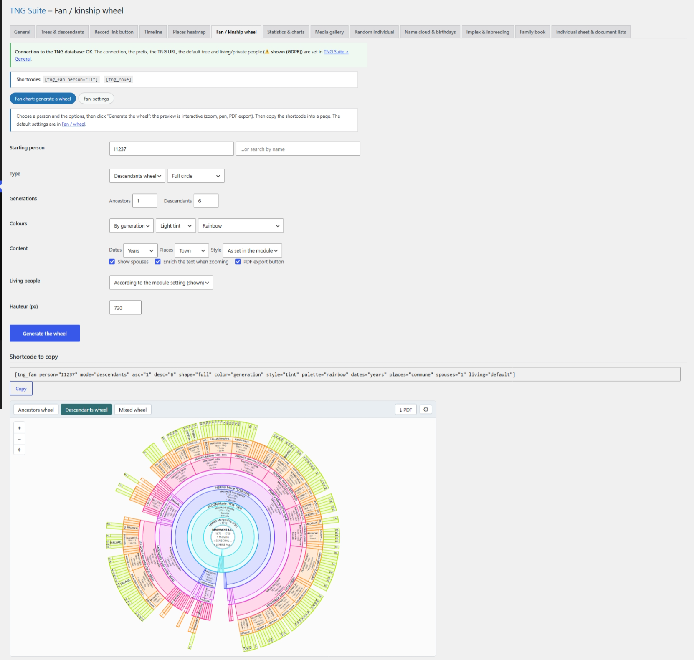

# Fan / kinship wheel

Ancestors, descendants or mixed wheel, interactive (zoom, pan, PDF export). The page has two sections: **Generate a wheel** (preview + shortcode to copy) and **Settings** (default values).

## In the admin

Menu **TNG Suite > Trees & visualisations**, sections **Fan chart: generate a wheel** and **Fan chart: settings**.



## Module settings

| Setting | Effect |
|---|---|
| Default starting person | TNG ID used when `person` is not given. |
| Type / Generations | Ancestors, descendants or mixed; number of generations (ancestors up to 12, descendants up to the configured cap). |
| Shape / Height | Full circle, three quarters or half circle; height in pixels. |
| Colouring / Style / Palette | By generation, branch or sex; light tint or solid; palette (Rainbow, Classic, Pastel, Vivid, Colour-blind, Blues, Earth, Greys) or custom palette. |
| Content: dates, places, first names, text style, spouses, zoom, unknown ancestors | Years / full dates / none; places (none, town, full); first name or all; symbols (° †) or letters (B: D: M:); spouses; text that gets richer when zooming; empty slots for unknown ancestors. |
| Who can see the chart | Everyone, logged-in users or administrators. |
| Cache (minutes) | How long wheel data is cached (30 by default). |

## Shortcodes

```
[tng_fan person="I1" asc="6"]
```

Ancestors wheel over 6 generations.

```
[tng_fan person="I1" mode="mixed" asc="4" desc="3" shape="half"]
```

Mixed half-circle wheel.

```
[tng_roue person="I1"]
```

French alias of `[tng_fan]`.

### Attributes

| Attribute | Values | Default | Role |
|---|---|---|---|
| person | I1 | {'fr': 'réglage', 'en': 'setting'} | Starting person (required if there is no default). |
| tree | {'fr': 'identifiant d’arbre', 'en': 'tree ID'} | {'fr': 'Général', 'en': 'General'} | Tree (gedcom). |
| mode | ancestors, descendants, mixed | {'fr': 'réglage', 'en': 'setting'} | Wheel type. |
| asc / desc | {'fr': '1–12 / 1–plafond', 'en': '1–12 / 1–cap'} | {'fr': 'réglage', 'en': 'setting'} | Ancestor / descendant generations. |
| shape | full, three, half | {'fr': 'réglage', 'en': 'setting'} | Full circle, three quarters, half circle. |
| color | generation, branch, sex | {'fr': 'réglage', 'en': 'setting'} | Colouring mode. |
| style | tint, solid | {'fr': 'réglage', 'en': 'setting'} | Light tint or solid colour. |
| palette | {'fr': 'id de palette ou `custom`', 'en': 'palette id or `custom`'} | {'fr': 'réglage', 'en': 'setting'} | Colour palette. |
| colors | {'fr': '`#aabbcc,#112233…`', 'en': '`#aabbcc,#112233…`'} | {'fr': '(vide)', 'en': '(empty)'} | Forced colours (up to 12), take priority over the palette. |
| dates | years, full, none | {'fr': 'réglage', 'en': 'setting'} | Date format. |
| places | none, commune, full | {'fr': 'réglage', 'en': 'setting'} | Places displayed. |
| spouses | 1 / 0 | {'fr': 'réglage', 'en': 'setting'} | Show spouses. |
| living | default, hide, show | default | `hide` hides living people; `show` displays them only if General allows it. |
| zoomdetail | 1 / 0 | {'fr': 'réglage', 'en': 'setting'} | Richer text when zooming. |
| labels | symbols, letters | {'fr': 'réglage', 'en': 'setting'} | Symbols (° †) or letters. |
| pdf | 1 / 0 | 1 | PDF export button. |
| controls | 1 / 0 | 1 | Zoom / navigation buttons. |
| height | {'fr': 'pixels', 'en': 'pixels'} | {'fr': 'réglage', 'en': 'setting'} | Wheel height. |
| class | {'fr': 'classe CSS', 'en': 'CSS class'} | {'fr': '(vide)', 'en': '(empty)'} | CSS class added to the container. |

## Usage

1. Section “Generate a wheel”: choose the person, type, generations, colours and content, then click **Generate the wheel**.
2. Check the preview, then copy the shortcode shown under the button.
3. Paste it in a page. Default values are set in the Settings section.

## Notes

- `living="show"` has no effect if “Always hide” is chosen in **General**.
- If access is restricted (logged-in / administrators), other visitors see a message instead of the chart.
- Results are cached; after a change in TNG, use **General > Maintenance > Flush caches** to see it immediately.

---
[← Modules guide](README.md)
