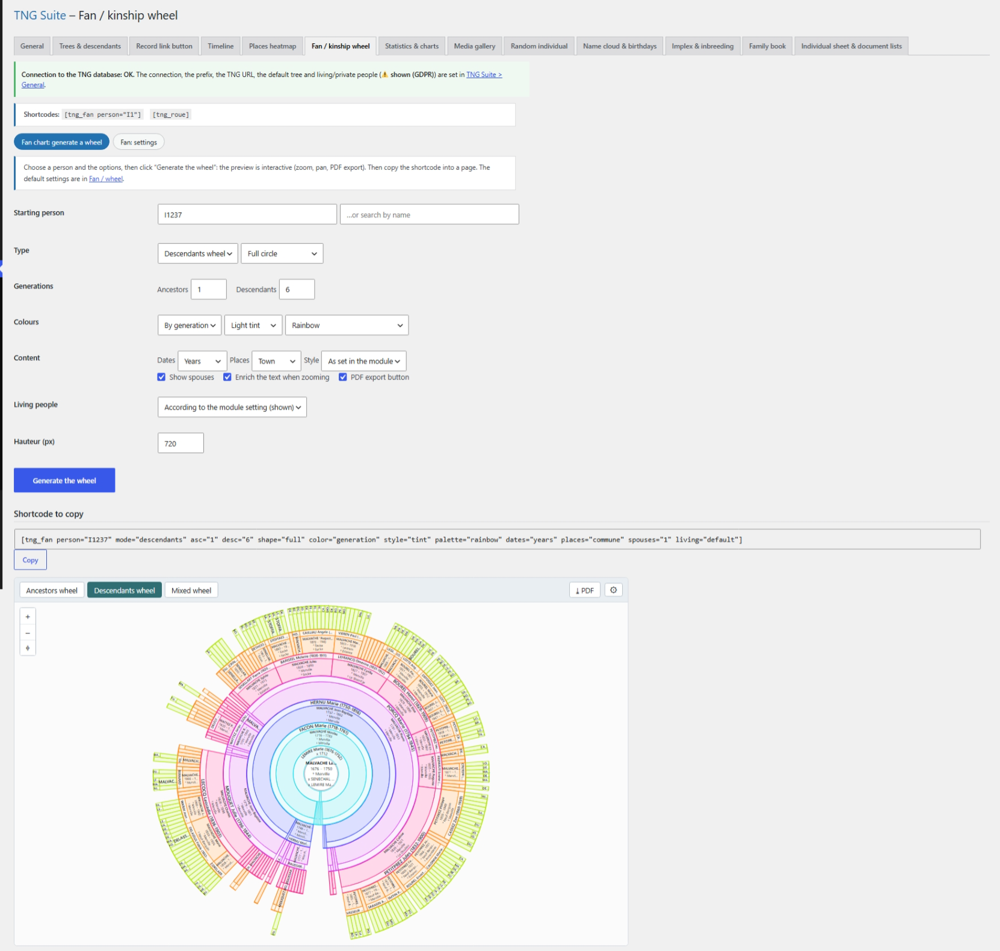

# Fan / kinship wheel

Ancestors, descendants or mixed wheel, interactive (zoom, pan, PDF export). The page has two sections: Generate a wheel and Settings.

## In the admin



## Shortcodes

```
[tng_fan person="I1" mode="descendants" asc="1" desc="6" shape="full" color="generation" style="tint" palette="rainbow" dates="years" places="commune" spouses="1" living="default" height="720"]
```

```
[tng_roue]
```

## How to use

1. “Generate a wheel” section: pick the person, type, generations, colours and content, then click Generate the wheel.
2. Check the preview, then copy the shortcode shown under the button.
3. Paste it into a page. Defaults are set in the Settings section.

## Notes

- living="show" does not work when “Always hide” is chosen in General.

---
[← Module guide](README.md)
