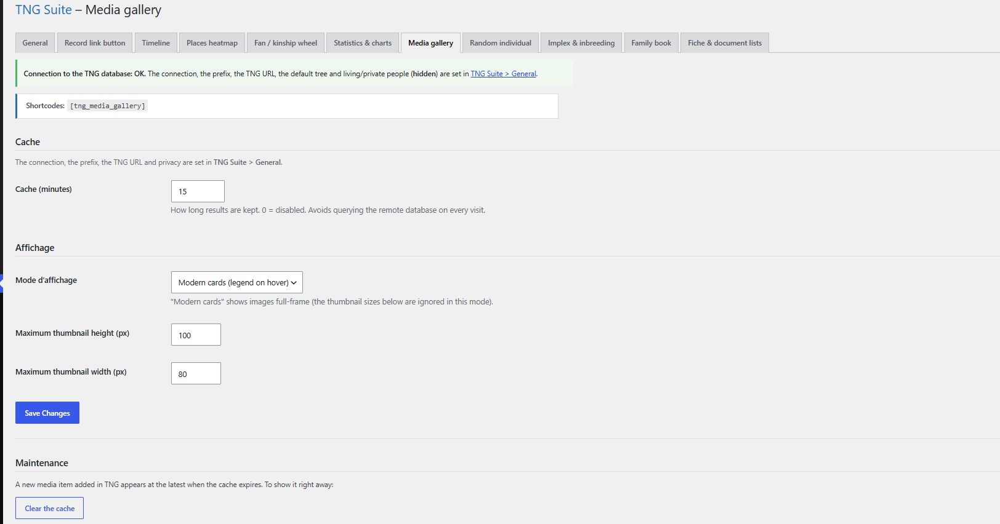

# Media gallery

Gallery of the photos and media of the tree, with lightbox (GLightbox), per person or surname.

## In the admin

Menu **TNG Suite > Media & widgets**, section **Media gallery**.



## Module settings

| Setting | Effect |
|---|---|
| Cache (minutes) | How long the media list is cached. |
| Display mode | Standard grid, Masonry (Pinterest) or Elegant gallery. |
| Max. thumbnail height / width (px) | Thumbnail size. |
| Maintenance | Button to flush the cache: otherwise a media added in TNG appears when the cache expires. |

## Shortcodes

```
[tng_media_gallery]
```

The latest 30 media.

```
[tng_media_gallery limit="60" surname="MARTIN"]
```

60 media of people named MARTIN.

```
[tng_media_gallery personid="I12"]
```

Media of one person.

### Attributes

| Attribute | Values | Default | Role |
|---|---|---|---|
| limit | 1 – 100 | 30 | Maximum number of media. |
| personid | I12 | {'fr': '(vide)', 'en': '(empty)'} | Restrict to one person. |
| surname | {'fr': 'nom', 'en': 'name'} | {'fr': '(vide)', 'en': '(empty)'} | Restrict to one surname. |

## Usage

1. Set the display and cache in the module section.
2. Paste the shortcode in a page.

## Result on the site


## Notes

- Media of living or private people are excluded according to **General > Modules**.
- Administrators see the detail of a connection error; visitors see nothing.
- GLightbox is loaded from a CDN unless a local copy is in `libs/`.

---
[← Modules guide](README.md)
