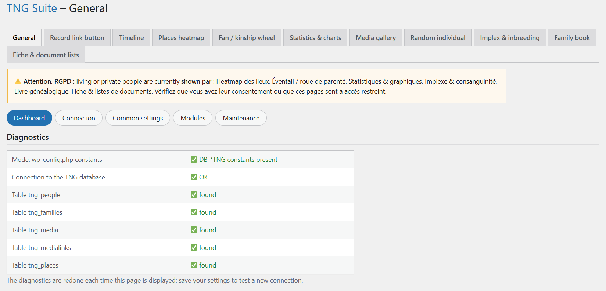

# General

Start page: it sets everything shared by the modules.

## In the admin

## How to use

1. Enter the TNG database connection (host, database, user, password) and the table prefix.
2. Enter the TNG URL and the default tree (gedcom).
3. Choose the language of the interface and of public texts (French or English).
4. For each module, decide whether living or private people are hidden (recommended, GDPR) or shown.
5. Turn modules on or off in the Modules section.

## Notes

- Each module has its own page; the connection never has to be entered again.

---
[← Module guide](README.md)
