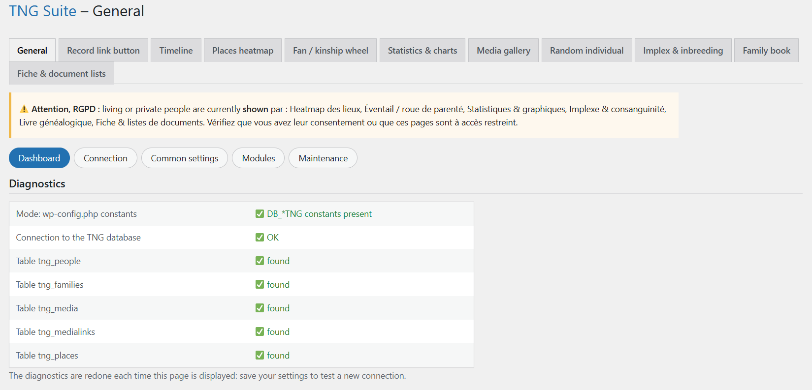

# General

Starting page of TNG Suite: it sets everything shared by the modules (connection to the TNG database, URL, prefix, default tree, language, privacy, module activation) and offers diagnostics and maintenance. The connection never has to be re-entered in a module.

## In the admin

Menu **TNG Suite > General**.

## Module settings

| Setting | Effect |
|---|---|
| Connection mode: wp-config.php (recommended) | Nothing is stored in the database. Add to `wp-config.php`, before “That’s all, stop editing!”: `DB_HOSTTNG`, `DB_NAMETNG`, `DB_USERTNG`, `DB_PASSWORDTNG` (optional: `DB_CHARSETTNG`, `DB_COLLATETNG`). |
| Connection mode: enter the credentials here | MySQL host (`localhost` or `host:port`), database name, user, password, charset. The password is **encrypted** (libsodium, WordPress security keys) and never displayed again; leave the field empty to keep it, or tick “Clear”. Use a **read-only** MySQL account (SELECT). |
| Connection mode: my TNG tables are in the WordPress database | No credentials: the TNG tables are read from the same database as WordPress. |
| Diagnostic | Tests the connection and the presence of the tables; redone each time the page is displayed (save your settings to test a new connection). |
| Language | Automatic (WordPress language), French or English: interface and public texts of the modules. Names, places and notes from your database are never translated. |
| URL of your TNG site | TNG address (e.g. `https://example.com/tng`), used for record links and photos. |
| TNG table prefix | Table prefix (`tng_` by default; letters, digits and `_`, 32 characters at most). |
| TNG tree ID | `gedcom` column: tree used by default. Leave empty for no filter (all trees). |
| Living / private (default) | Hide living or private people (recommended, GDPR). Value used by modules set to “Same as the shared setting”. |
| Tree cache (hours) | 0 = no cache (12 by default). The other modules have their own duration in their section. |
| Modules table | For each module: enabled / disabled and Living / private setting (Same as the shared setting, Hide, Show ⚠️ GDPR). “Record link button” follows “Trees & descendants”; “Random individual” follows “Name cloud & birthdays”; the latter two are hidden by default. |
| Maintenance: flush all caches | Flushes the caches of all modules; useful after a change in TNG. |
| Migration from the old plugins | If old standalone plugins are detected, their settings are imported and compared; deactivate them to enable the matching modules. A button clears the MySQL passwords they still keep in clear text. |

## Usage

1. Choose the connection mode and fill in the TNG database; check the **Diagnostic**.
2. Enter the TNG URL, the table prefix and the default tree.
3. Choose the language and the Living / private setting (keep “Hide” unless you have a specific need).
4. Enable the wanted modules: each one appears in the menu of its family (Trees & visualisations, Analyses, Documents, Media & widgets).
5. Save.

## Notes

- The MySQL account should only have read access (SELECT) on the TNG tables.
- On uninstall (deleting the plugin), settings, caches, scheduled tasks and the `tngi_inbreeding` table are removed; your TNG data and the old plugins are never touched.
- Automatic updates come from the plugin’s GitHub Releases; disable them with `define( 'TNGSUITE_GITHUB_REPO', '' );` in `wp-config.php`.

---
[← Modules guide](README.md)
