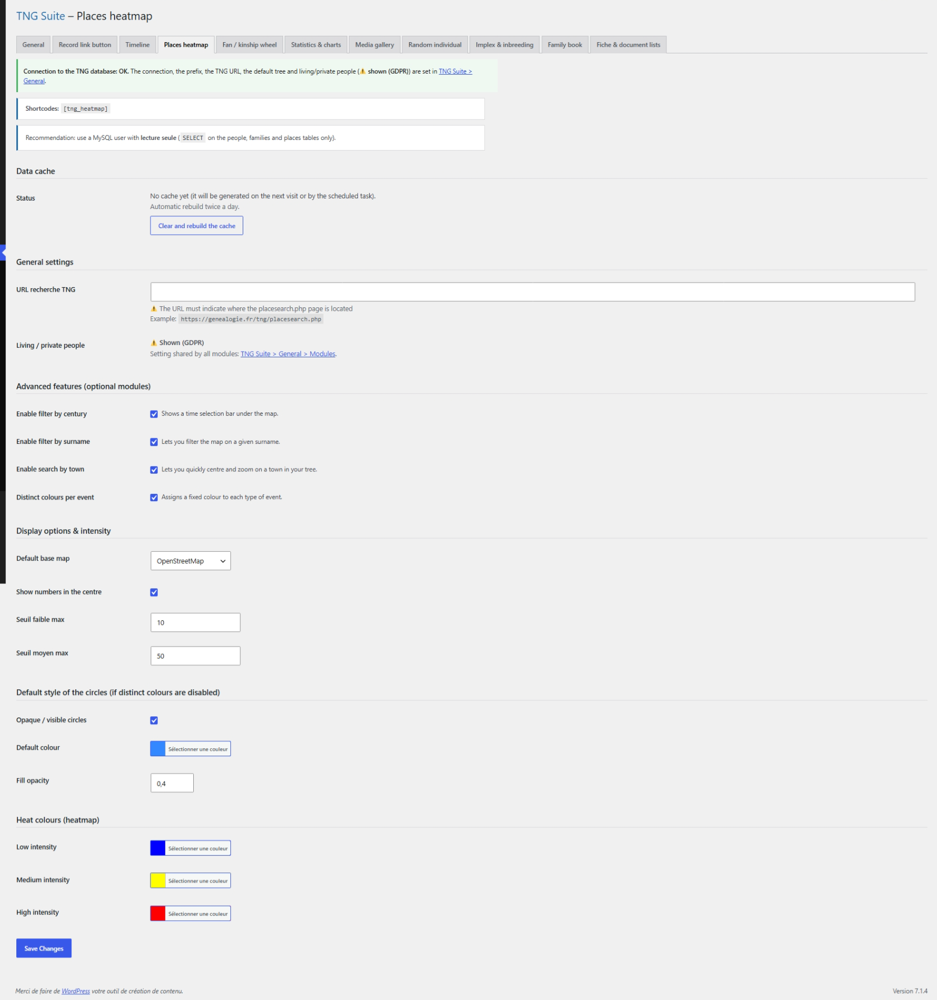

# Places heatmap

Heat map of birth, marriage, death… places in the tree.

## In the admin



## Shortcodes

```
[tng_heatmap]
```

## How to use

1. Choose the events taken into account and the map style on the module page.
2. Paste the shortcode into a page.

## Result on the site


## Notes

- Base map: 8 choices, all free with no API key or sign-up (OpenStreetMap, OpenStreetMap France, OpenTopoMap, Esri). Esri Light Gray is the most understated for reading the heatmap colours; Esri Streets and OpenStreetMap France are the most legible for place names.
- Places need coordinates in TNG.

---
[← Module guide](README.md)
