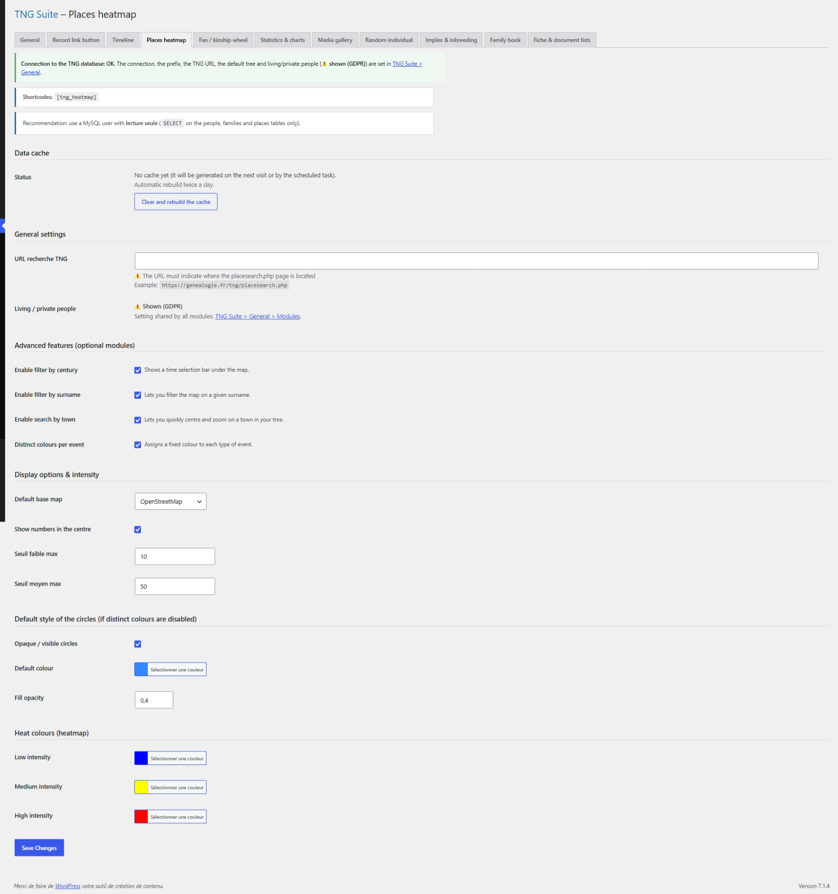

# Places heatmap

Heat map of birth, baptism, marriage, death… places of the tree, with filters by event, century, surname and town. Leaflet is loaded from a CDN (unless a local copy exists); places must have coordinates in TNG.

## In the admin

Menu **TNG Suite > Stats & analyses**, section **Places heatmap**.



## Module settings

| Setting | Effect |
|---|---|
| Data cache | Shows the cache state (aggregated rows), the last error if any, and a button to purge the cache. Data is regenerated automatically twice a day. |
| TNG search URL | Address of TNG’s place search page (e.g. `https://example.com/tng/placesearch.php`), used by the popup links. |
| Living / private people | Read-only display of the shared setting (General > Modules). |
| Advanced features | Enable or not: century filter, surname filter, town search, distinct colours per event. |
| Default base map | 8 free base maps, no API key: Esri Light Grey (default), OpenStreetMap, OpenStreetMap France, OpenTopoMap, Esri Streets / Topographic / Imagery / Oceans. |
| Show numbers in the centre | Number of events in each circle, from regional zoom and without overlapping. |
| Default circle style | Opaque circles, fill colour and opacity (used if “distinct colours” is off). |
| Heat colours | Low, medium, high intensity; **Back to the recommended palette** button. |

## Shortcodes

```
[tng_heatmap]
```

Displays the map. No attribute: everything is set in the module section (one per page is recommended).

## Usage

1. Check the search URL and choose the base map, filters and colours.
2. Paste `[tng_heatmap]` in a page.

## Result on the site


## Notes

- Living or private people follow the **General > Modules** setting (hidden by default, recommended for GDPR).
- Base map: Esri Light Grey is the most neutral to read the colours; Esri Streets and OpenStreetMap France are the most readable for place names. The tile provider receives the visitor’s IP address.
- Colours: by default light orange (low), dark orange (medium), dark red (high). The scale is logarithmic: only the biggest hotspot of the displayed selection reaches the high colour.
- Numbers in the centre: visible from regional scale (zoom 8); a number that would overlap another is omitted until the next zoom. The count remains visible in the tooltip.
- The map is not generated in editor previews (REST requests).

---
[← Modules guide](README.md)
