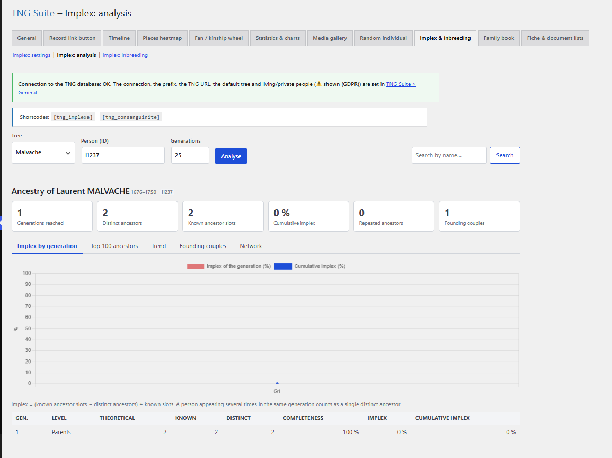

# Implex & inbreeding

Analysis of implex (repeated ancestors) and inbreeding. Three sections: Analysis, Inbreeding, Settings.

## In the admin



## Shortcodes

```
[tng_implexe]
```

```
[tng_consanguinite tree="mytree" per_page="50"]
```

## How to use

1. Analysis section: choose the tree, person and generations, then Analyse (charts, top ancestors, founding couples, network).
2. Inbreeding section: run the calculation to rank people.
3. Settings section: public display options.

## Notes

- Implex = (known ancestor slots − distinct ancestors) ÷ known slots.

---
[← Module guide](README.md)
