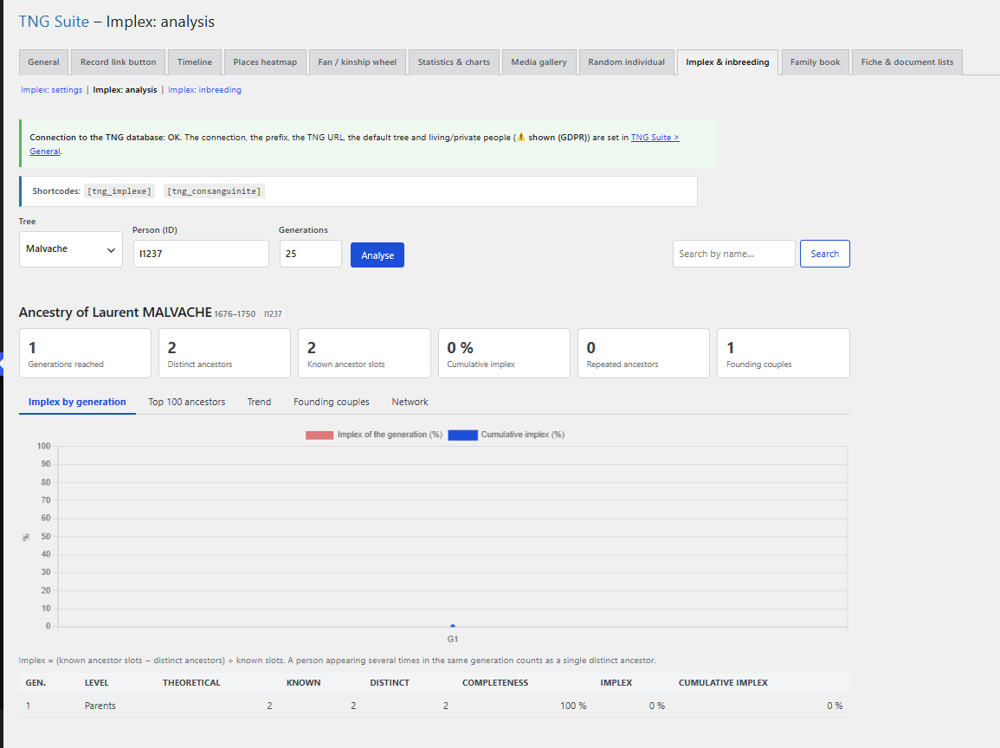

# Implex & inbreeding

Analysis of implex (ancestors appearing several times) and inbreeding. Three sections: **Analysis**, **Inbreeding** and **Settings**. Chart.js and vis-network are loaded from a CDN unless a local copy exists.

## In the admin

Menu **TNG Suite > Stats & analyses**, sections **Implex: analysis**, **Implex: inbreeding** and **Implex: settings**.



## Module settings

| Setting | Effect |
|---|---|
| Default starting person | TNG ID used when `person` is not given. |
| Maximum generations | Cap on analysed generations (25 by default). |
| Network generations | Depth of the network graph (6 by default, 10 at most). |
| Who can see the results (shortcode) | Everyone, logged-in users (default) or administrators. |
| Cache (minutes) | How long analyses are cached (60 by default). |

## Shortcodes

```
[tng_implexe person="I1" generations="12"]
```

Implex analysis: charts, most frequent ancestors, founding couples, network.

```
[tng_consanguinite per_page="50"]
```

Ranking of people by inbreeding coefficient (calculated by an administrator, results stored in the `tngi_inbreeding` table).

### `[tng_implexe]`

| Attribute | Values | Default | Role |
|---|---|---|---|
| tree | tree ID | General setting | Tree (gedcom). |
| person | I1 | setting | Starting person. |
| generations | 2 – max | setting maximum | Analysed generations. |
| network_generations | 2 – 10 | setting | Network generations. |

### `[tng_consanguinite]`

| Attribute | Values | Default | Role |
|---|---|---|---|
| tree | tree ID | General setting | Tree (gedcom). |
| per_page | 10 – 100 | 50 | Rows per page. |

## Usage

1. Analysis section: choose the tree, person and number of generations, then **Analyse**.
2. Inbreeding section: run the calculation (in batches) to rank people.
3. Settings section: defaults, access and cache; then paste the shortcodes in a page.

## Notes

- Implex = (known ancestor slots − distinct ancestors) ÷ known slots.
- Public analyses go through the plugin’s REST API and honour the “Who can see” setting; the inbreeding calculation is reserved to administrators.
- The `tngi_inbreeding` table is created in the WordPress database and removed when the plugin is uninstalled.
- Living or private people follow the **General > Modules** setting (hidden by default, recommended for GDPR).

---
[← Modules guide](README.md)
