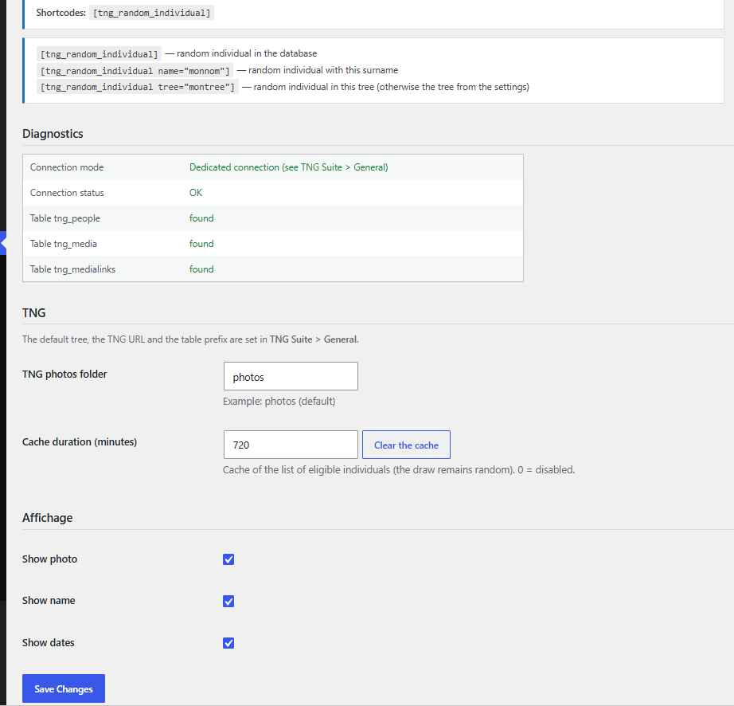

# Random individual

Displays a randomly drawn person (with photo, name and dates), or restricted to a surname. Enabled and protected (living / private) together with the Name cloud & birthdays module: hidden by default.

## In the admin

Menu **TNG Suite > Media & widgets**, section **Random individual**.



## Module settings

| Setting | Effect |
|---|---|
| TNG photos directory | TNG photos folder (default: `photos`). |
| Cache duration (minutes) | How long the list of candidate people is kept. |
| Show photo / name / dates | Items displayed on the card. |
| Placeholder without photo | Portrait (circle on a light background) or Round (no background) when the person has no photo. |

## Shortcodes

```
[tng_random_individual]
```

A random person in the default tree.

```
[tng_random_individual name="MARTIN" tree="monarbre"]
```

Draw restricted to a surname and a tree.

### Attributes

| Attribute | Values | Default | Role |
|---|---|---|---|
| name | {'fr': 'nom de famille', 'en': 'surname'} | {'fr': '(vide : tous)', 'en': '(empty: all)'} | Restricts the draw to this surname. |
| tree | {'fr': 'identifiant d’arbre', 'en': 'tree ID'} | {'fr': 'arbre de Général', 'en': 'tree from General'} | Tree (gedcom). |

## Usage

1. Set the displayed content (photo, name, dates) and the photos directory.
2. Paste the shortcode; `name` restricts the draw to a surname.

## Result on the site


## Notes

- Living or private people follow the **General > Modules** setting (hidden by default, recommended for GDPR). For this module the default is “Always hide”.
- A generic message (“Content temporarily unavailable”) is shown to visitors if the database is unreachable; the detail is only visible to administrators.
- Results are cached; after a change in TNG, use **General > Maintenance > Flush caches** to see it immediately.

---
[← Modules guide](README.md)
