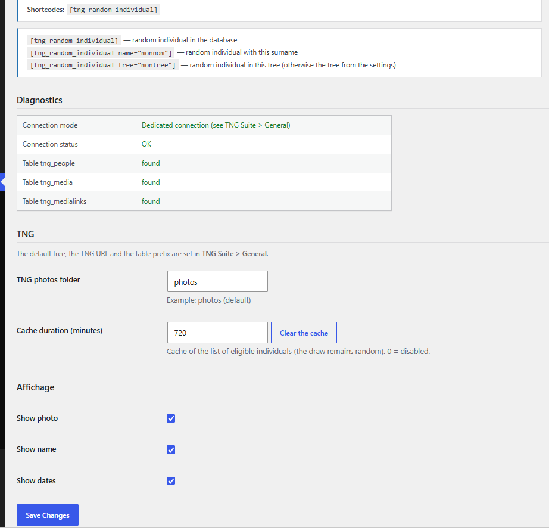

# Random individual

Shows a random person (or a given surname).

## In the admin



## Shortcodes

```
[tng_random_individual]
```

```
[tng_random_individual name="SMITH"]
```

## How to use

1. Set the displayed content on the module page.
2. Paste the shortcode; name limits the draw to a surname, tree to a tree.

## Result on the site


---
[← Module guide](README.md)
