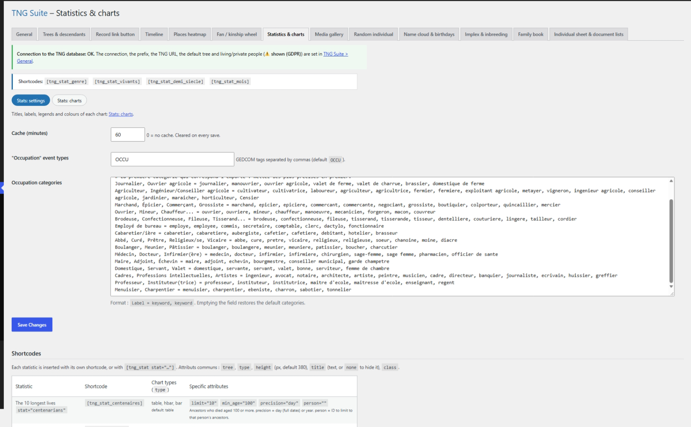

# Statistics & charts

Public charts (sex, living, half-centuries, months…). Two sections: Settings and Charts (title, labels, colours of each chart).

## In the admin



## Shortcodes

```
[tng_stat_genre]
```

```
[tng_stat_vivants]
```

```
[tng_stat_demi_siecle]
```

```
[tng_stat_mois]
```

```
[tng_stat_esperance basis="birth" min_age="0" min_n="5"]
```

```
[tng_stat_pyramide step="10"]
[tng_stat_pyramide year="1850"]
```

Life expectancy: average age at death by century of birth (`basis="death"` for century of death), men, women and all. `min_age="5"` leaves out infant mortality. Age pyramid: without `year`, ages at death; with `year`, ages of people alive that year.


```
[tng_stat type="…" height="380"]
```

## How to use

1. Settings section: general statistics options.
2. Charts section: rename titles, labels and colours of each chart.
3. Paste the wanted chart shortcode into a page.

## Result on the site


## Notes

- Only totals are published.

---
[← Module guide](README.md)
