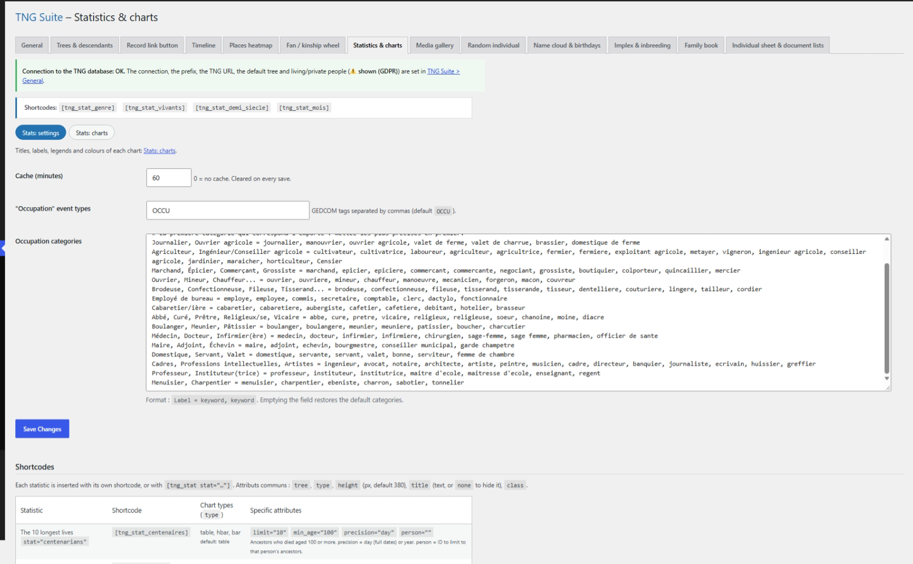

# Statistics & charts

Public charts built from the TNG database: gender, living, births and deaths per half-century or month, life expectancy, age pyramid, age at marriage, mean distance, towns, occupations, longest lives. Only **totals** are published. Chart.js is loaded from a CDN unless a local copy is placed in `libs/`.

## In the admin

Menu **TNG Suite > Analyses**, sections **Stats: settings** and **Stats: charts**.



## Module settings

**Settings section**

| Setting | Effect |
|---|---|
| Cache (minutes) | How long each chart’s results are cached. |
| “Occupation” event types | TNG event types that contain the occupation (for the occupations chart). |
| Occupation categories | Group occupations: a label and the terms that make it up (one category per line). |
| Unclassified occupations | List of the terms found that match no category, to complete your categories. |
| Charts section: palette | Default palette for all charts (preset palettes or “My custom palette”). |
| Charts section: for each chart | Title, chart type, labels (legend, table), axis titles, legend, note under the chart and colours. |

## Shortcodes

One shortcode per statistic, plus the generic `[tng_stat stat="…"]` shortcode (the value of `stat` is the key in the first column).

```
[tng_stat_genre]
```

Men / women / unknown split.

```
[tng_stat_esperance min_age="5" min_n="5"]
```

Life expectancy per century, excluding infant mortality.

```
[tng_stat_pyramide year="1850" step="10"]
```

Age pyramid of people alive in 1850.

```
[tng_stat_villes limit="15" source="birth,death" type="hbar"]
```

Top 15 towns of birth and death.

```
[tng_stat stat="gender" type="doughnut" height="320"]
```

Generic form: `stat` = statistic key, `type` = chart type.

### Attributes common to all charts

| Attribute | Values | Default | Role |
|---|---|---|---|
| type | depends on the statistic (see below) | first type in the list | Chart type: `pie`, `doughnut`, `polarArea`, `bar`, `hbar`, `line`, `area`, `radar`, `pyramid` or `table`. |
| tree | tree ID | tree from General | Tree (gedcom). |
| height | pixels | 380 | Chart height. |
| title | text | title from settings | Overrides the title. |
| class | CSS class | (empty) | CSS class added to the container. |

### Available statistics

| Attribute | Values | Default | Role |
|---|---|---|---|
| centenarians — `[tng_stat_centenaires]` | table, hbar, bar | table | Longest lives. `limit` (10), `min_age` (100), `precision` (`day` or `year`), `person` (restrict to a person’s ancestors). |
| gender — `[tng_stat_genre]` | pie, doughnut, polarArea, bar, hbar, table | doughnut | Men, women, unknown (living included). |
| living — `[tng_stat_vivants]` | same | polarArea | Number of deceased and living people (totals only). Labels can be renamed in Stats: charts. |
| marriage_age — `[tng_stat_age_union]` | line, area, bar, table | line | Mean age at first marriage (M/F) per century. `min_n` (3): minimum cases per century and sex. |
| life_expectancy — `[tng_stat_esperance]` | line, area, bar, table | line | Mean age at death per century of death. `min_age` (0; 5 or 20 to exclude infant mortality), `min_n` (5). |
| pyramid — `[tng_stat_pyramide]` | pyramid, bar, table | pyramid | Without `year`: ages at death (men left, women right). With `year="1850"`: ages of people alive that year. `step` (10; 5 or 10), `max_age` (100). |
| distance — `[tng_stat_distance]` | line, area, bar, hbar, table | line | Mean distance in km between birth and death (geolocated places required). `from` (1650), `to` (2024), `step` (75), `basis` (`death` or `birth`). |
| half_century — `[tng_stat_demi_siecle]` | bar, line, area, table | bar | Births and deaths per period. `from` (1200), `to` (2000), `step` (50; 25, 100…). |
| months — `[tng_stat_mois]` | area, line, bar, radar, table | area | Births and deaths per month. |
| places — `[tng_stat_villes]` | hbar, bar, pie, doughnut, polarArea, table | hbar | Main towns. `limit` (20), `level` (1 = before the first comma), `source` (`birth,baptism,marriage,death,burial` or `all`), `others` (1 to add “Others”). |
| occupations — `[tng_stat_metiers]` | pie, doughnut, polarArea, bar, hbar, table | pie | Main occupations in %. `limit` (15), `others` (0; 1 to show unclassified occupations). See the “occupation” settings above. |

## Usage

1. Settings section: cache, “occupation” event types and occupation categories.
2. Charts section: palette, titles, labels and colours of each chart.
3. Paste the shortcode of the wanted chart in a page.

## Result on the site


## Notes

- Only totals are published (no names).
- If a type is not allowed for the statistic, the default type is used.
- Results are cached; after a change in TNG, use **General > Maintenance > Flush caches** to see it immediately.

---
[← Modules guide](README.md)
