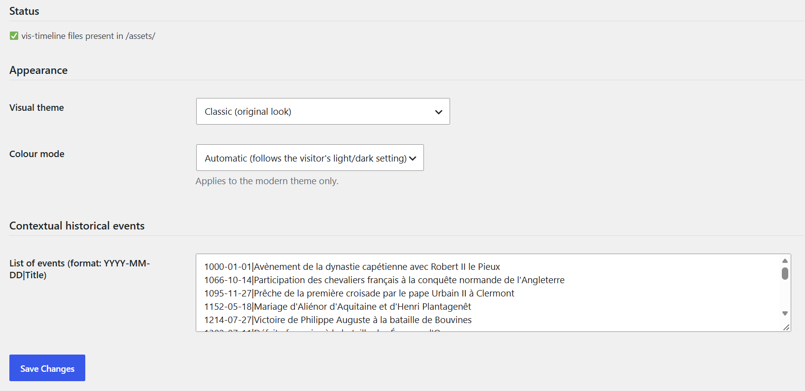

# Timeline

Interactive timeline of the events of a person or a family (birth, baptism, marriage, children, death…), optionally with historical events in the background. The vis-timeline library is bundled in the plugin (no external loading).

## In the admin

Menu **TNG Suite > Trees & visualisations**, section **Timeline**.



## Module settings

| Setting | Effect |
|---|---|
| Visual theme | Classic (original look) or Modern (rounded card, soft shadows, coloured accents). |
| Colour mode | Automatic (follows the visitor’s light / dark setting), always light or always dark. |
| Hide living or private people | Applies to the modern theme; value taken from General > Modules. |
| Historical events list | One event per line, in the format `YYYY-MM-DD\|Title` (e.g. `1789-07-14\|Fall of the Bastille`). They are shown in the background of every timeline. |

## Shortcodes

```
[tng_timeline person="I1"]
```

Timeline of a person.

```
[tng_timeline family="F12" tree="monarbre"]
```

Timeline of a family (couple and children).

### Attributes

| Attribute | Values | Default | Role |
|---|---|---|---|
| person | I1 | (empty) | Person ID. `person` or `family` is required. |
| family | F12 | (empty) | Family ID. |
| tree | tree ID | tree from General | Tree (gedcom). |

## Usage

1. Choose the theme and colour mode, optionally add historical events.
2. Paste the shortcode with `person` (or `family`) and, if needed, `tree`.

## Result on the site


## Notes

- Living or private people follow the **General > Modules** setting (hidden by default, recommended for GDPR).
- Results are cached; after a change in TNG, use **General > Maintenance > Flush caches** to see it immediately.
- Without `person` or `family`, a help message is displayed instead of the timeline.

---
[← Modules guide](README.md)
