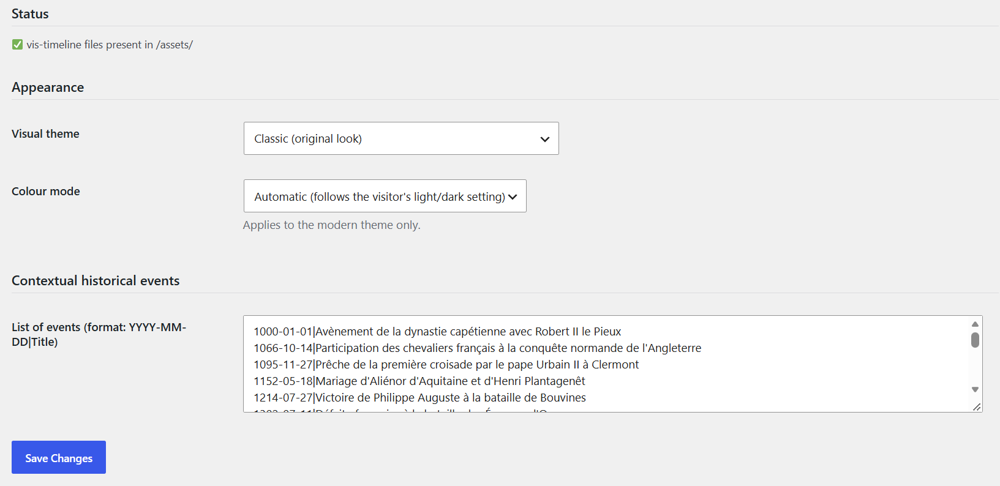

# Timeline

Timeline of the events of a person or a family.

## In the admin



## Shortcodes

```
[tng_timeline person="I1"]
```

```
[tng_timeline family="F1"]
```

## How to use

1. Choose the look and the event types on the module page.
2. Paste the shortcode with person (or family) and, if needed, tree.

## Result on the site


---
[← Module guide](README.md)
