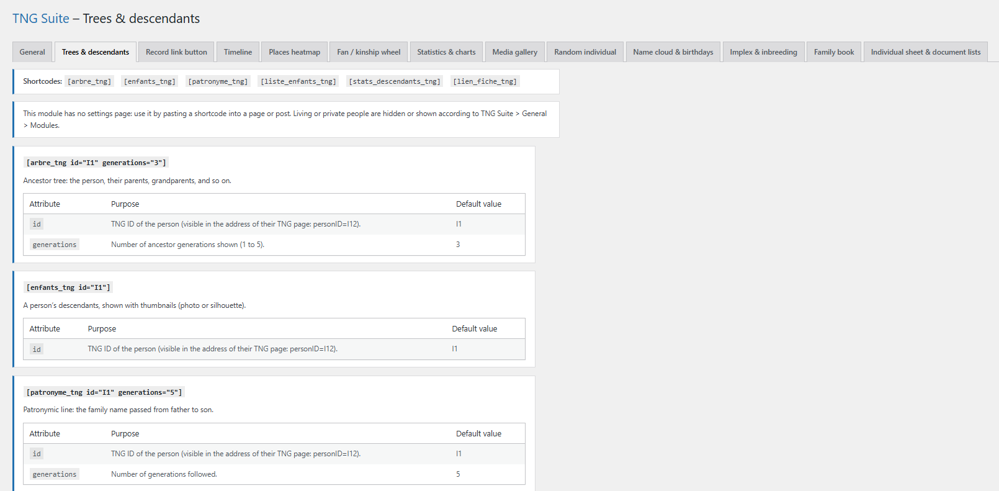

# Trees & descendants

Ancestor trees, descendants with thumbnails, patronymic line, lists and links to the TNG page. This module has no settings: its admin page is a help page listing each shortcode, its attributes and an example.

## In the admin



## Shortcodes

```
[arbre_tng id="I1" generations="3"]
```

```
[enfants_tng id="I1"]
```

```
[patronyme_tng id="I1" generations="5"]
```

```
[liste_enfants_tng]
```

```
[stats_descendants_tng]
```

```
[lien_fiche_tng]
```

## How to use

1. Find the person’s TNG ID (in the address of their page: personID=I12).
2. Paste the shortcode into a page or post with the wanted id.
3. Publish: the tree appears and the links lead to the TNG page.

## Result on the site


## Notes

- Living or private people follow the setting in General > Modules.

---
[← Module guide](README.md)
