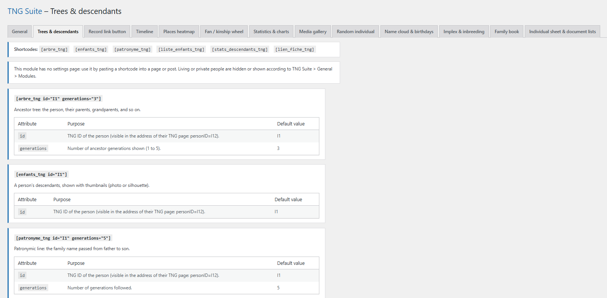

# Trees & descendants

Ancestor trees, descendants with thumbnails, patronymic line, lists and links to the TNG record. This module has no settings of its own: the admin page is a help page listing each shortcode, its attributes and an example. Connection, prefix and privacy are set in **General**.

## In the admin

Menu **TNG Suite > Trees & visualisations**, section **Trees & descendants**.



## Shortcodes

```
[arbre_tng id="I1" generations="3"]
```

Ancestor tree: the person, parents, grandparents…

```
[enfants_tng id="I1"]
```

Descendants of a person, shown with thumbnails (photo or silhouette).

```
[patronyme_tng id="I1" generations="5"]
```

Patronymic line: the surname passed from father to son.

```
[liste_enfants_tng id="F12"]
```

List of the children of a **family** (couple): `id` is a family ID (F12…), required.

```
[stats_descendants_tng id="I1"]
```

Descendant statistics: number of descendants at each generation.

```
[lien_fiche_tng id="I1"]
```

Button linking to the person’s TNG record (see also the “Record link button” module, which is more customisable).

### Attributes

| Attribute | Values | Default | Role |
|---|---|---|---|
| id | I1, I25… | I1 | TNG person ID (`personID=I12` in the page address); for `liste_enfants_tng`, the family ID (F12). |
| generations | {'fr': 'nombre entier', 'en': 'whole number'} | {'fr': '3 (arbre), 5 (patronyme)', 'en': '3 (tree), 5 (patronymic)'} | Number of generations. Cap: 5 for `arbre_tng`, 30 for `patronyme_tng`, 15 levels for descendants. |

## Usage

1. Find the TNG ID of the person (`personID=I12` in the page address).
2. Paste the shortcode in a page or post with the wanted `id`.
3. Publish: the tree is displayed and links lead to the TNG record.

## Result on the site


## Notes

- Living or private people follow the **General > Modules** setting (hidden by default, recommended for GDPR).
- Results are cached; after a change in TNG, use **General > Maintenance > Flush caches** to see it immediately.
- Generation limits can be changed in code with the filters `tng_max_ancestor_generations`, `tng_max_patronymic_generations` and `tng_max_descendant_generations`.

---
[← Modules guide](README.md)
