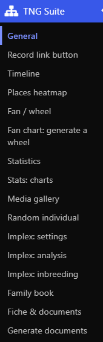

# TNG Suite – Guide des modules

Ce guide présente chaque module : où le régler, comment l’utiliser et à quoi il ressemble. Anglais : [English guide](../en/README.md).

- [Général](general.md)
- [Arbres & descendance](trees.md)
- [Bouton vers la fiche](link.md)
- [Frise chronologique](timeline.md)
- [Heatmap des lieux](heatmap.md)
- [Éventail / roue de parenté](fan.md)
- [Statistiques & graphiques](stats.md)
- [Galerie de médias](gallery.md)
- [Individu au hasard](random.md)
- [Nuage de noms & anniversaires](extra.md)
- [Implexe & consanguinité](implexe.md)
- [Livre généalogique](book.md)
- [Fiche & listes de documents](fiche.md)
