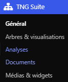

# TNG Suite – Guide des modules

Ce guide présente chaque module : où le régler, comment l’utiliser et à quoi il ressemble. Anglais : [English guide](../en/README.md).

Le menu **TNG Suite** compte cinq entrées : **Général** et quatre familles. Chaque ancienne page d’administration est une section de sa famille (barre de sections en haut de la page) :

| Entrée du menu | Contient |
|---|---|
| Général | connexion, réglages communs, modules, maintenance |
| Arbres & visualisations | Arbres & descendance, Bouton vers la fiche, Frise chronologique, Éventail |
| Analyses | Statistiques & graphiques, Heatmap des lieux, Implexe & consanguinité |
| Documents | Livre généalogique, Fiche & listes de documents |
| Médias & widgets | Galerie de médias, Nuage de noms & anniversaires, Individu au hasard |

« Bouton vers la fiche » est activé avec « Arbres & descendance », et « Individu au hasard » avec « Nuage de noms & anniversaires » (une seule case d’activation et un seul réglage « Vivants / privés » pour chaque couple) ; leurs shortcodes sont inchangés.

- [Général](general.md)
- [Arbres & descendance](trees.md)
- [Bouton vers la fiche](link.md)
- [Frise chronologique](timeline.md)
- [Heatmap des lieux](heatmap.md)
- [Éventail / roue de parenté](fan.md)
- [Statistiques & graphiques](stats.md)
- [Galerie de médias](gallery.md)
- [Individu au hasard](random.md)
- [Nuage de noms & anniversaires](extra.md)
- [Implexe & consanguinité](implexe.md)
- [Livre généalogique](book.md)
- [Fiche & listes de documents](fiche.md)
