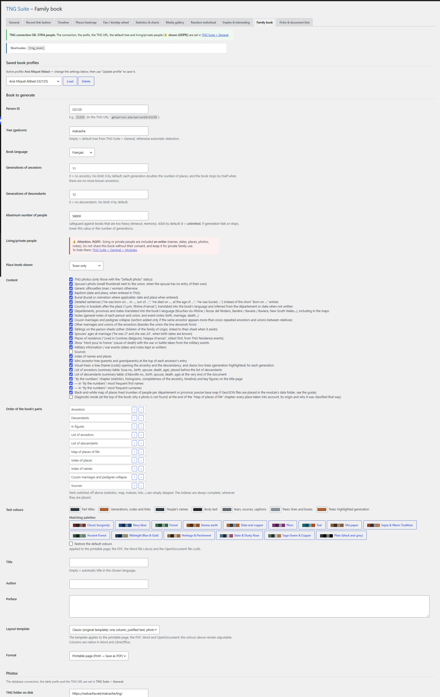

# Livre généalogique

Génère un livre complet (ascendance, descendance, index, cartes, statistiques) en page imprimable/PDF, Word (.docx) ou OpenDocument (.odt), en français, anglais, espagnol ou catalan.

## Dans l’administration



## Shortcodes

```
[tng_book]
```

## Utilisation

1. Saisissez l’identifiant de la personne, l’arbre et le nombre de générations.
2. Cochez le contenu voulu, ordonnez les parties, choisissez couleurs et modèle de mise en page.
3. Choisissez le format puis générez. Un profil peut être enregistré et rechargé.

## Résultat sur le site


## Remarques

- Page sur le patronyme : un éditeur (mise en forme, tableaux, images) permet de rédiger une page de présentation du nom ; elle est enregistrée dans le profil du livre et se place dans « Ordre des parties ». Vide = pas de page.
- Chronologie familiale : option à cocher (désactivée par défaut) ; ajoute une partie qui liste, par ordre chronologique et regroupés par décennie, les naissances, mariages et décès des personnes du livre (avec renvoi vers leur fiche, lieu et âge au décès). Les personnes masquées (vivantes) en sont exclues. Elle se place dans « Ordre des parties » comme toutes les autres.
- Chaque partie commence sur une nouvelle page.
- Le shortcode [tng_book] ouvre le générateur aux visiteurs connectés si l’option est activée.
- Les personnes vivantes sont incluses en entier si vous choisissez de les afficher : ne diffusez pas ce livre sans accord.

---
[← Guide des modules](README.md)
