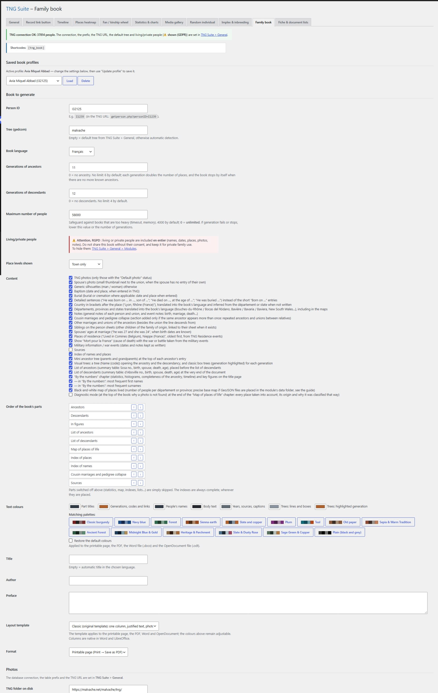

# Livre généalogique

Génère un livre complet (ascendance, descendance, index, cartes, statistiques) en page imprimable/PDF, Word (.docx) ou OpenDocument (.odt), en français, anglais, espagnol ou catalan.

## Dans l’administration

Menu **TNG Suite > Documents > Livre généalogique**.




## Shortcodes

```
[tng_book]
```

## Utilisation

La page (onglet **Documents**) comporte trois sections : **Livre : générer un livre**, **Livre : réglages** et **Livre : vue d’ensemble des profils**. Quand des profils existent, la section « Générer un livre » n’affiche d’abord que le choix du profil : chargez un profil ou cliquez sur **Nouveau livre** pour afficher le formulaire (sans profil, il s’affiche directement). Les photos, le formulaire public et les réglages de la génération automatique sont dans la section **Réglages**.

1. Saisissez l’identifiant de la personne, l’arbre et le nombre de générations.
2. Cochez le contenu voulu, ordonnez les parties, choisissez couleurs et modèle de mise en page.
3. Choisissez le format puis générez. Un profil peut être enregistré et rechargé.

## Résultat sur le site


## Remarques

- Réglages regroupés : les options sont classées en « Contenu des fiches », « Parties du livre », « Poids du fichier » et « Options avancées » (mode diagnostic). Plusieurs réglages sont réunis en un seul choix : Photos (aucune / photos avec photo du conjoint / photos et silhouettes), Baptême et sépulture (aucun / sépulture / les deux), Chronologie (aucune / familiale / avec contexte historique), et des cases uniques pour les phrases détaillées (avec âge des époux au mariage et lieux de résidence), les lieux traduits (pays et départements), les informations militaires (guerre et « Mort pour la France »), les arbres (mini-arbre et arbres visuels), les listes récapitulatives et le chapitre « En chiffres » (prénoms et noms fréquents inclus). Les réglages déjà enregistrés et les profils sont convertis automatiquement.
- Page sur le patronyme : un éditeur (mise en forme, tableaux, images) permet de rédiger une page de présentation du nom ; elle est enregistrée dans le profil du livre et se place dans « Ordre des parties ». Vide = pas de page. Les images alignées à gauche ou à droite dans l’éditeur gardent leur place, avec le texte autour, dans le PDF, le Word et l’OpenDocument.
- Silhouettes : pour les personnes sans photo, « Style des silhouettes génériques » permet de choisir entre le portrait (cercle sur fond clair) et le rond (sans fond).
- Enfants des couples dans l’ascendance : option à cocher (activée par défaut) pour les modèles Classique, Élégant et Moderne. Sous la phrase de mariage de l’ancêtre, « X et Y ont N enfants : » suivi de la liste (années de vie, renvoi vers la fiche pour l’enfant de la lignée). La liste figure dans la fiche du mari (ou du seul conjoint présent) pour ne pas être répétée. Dans la descendance, la liste d’enfants porte la même phrase avec le nombre d’enfants.
- Contexte historique dans les fiches : option à cocher (désactivée par défaut). Sous la fiche d’une personne, une ligne en italique du type « Contexte historique : la Première Guerre mondiale et la Seconde Guerre mondiale » énumère, d’après les listes de faits historiques cochées, les périodes (guerres, régimes…) dans lesquelles tombe la naissance (ou le baptême), un mariage ou le décès (ou l’inhumation), ainsi que celles traversées de son vivant quand le décès (ou l’inhumation) est connu et que la personne était sûrement en vie avant la fin de la période (naissance ou baptême connus, à défaut un mariage) ; sans date de décès, rien n’est affirmé. Un décès deux jours après l’armistice compte donc : la personne a vécu la guerre. Les noms des périodes sont repris tels qu’ils sont écrits dans les listes, sans traduction ni phrase composée (pas de mélange de langues). Une date imprécise n’est retenue que si toutes ses possibilités sont dans la période (une naissance « 1914 » n’est pas comptée dans la guerre qui commence en août). Les événements datés (`date | texte`) des listes ne figurent pas dans les fiches mais dans la **chronologie familiale** (réglage « avec contexte historique »), où ils se replacent par date et par décennie ; seules les périodes (`date .. date | nom`) alimentent la ligne des fiches : une liste faite d’événements seulement n’ajoute donc rien aux fiches. Indépendant de la chronologie.
- Chronologie familiale : option à cocher (désactivée par défaut) ; ajoute une partie qui liste, par ordre chronologique et regroupés par décennie, les naissances, mariages et décès des personnes du livre (avec renvoi vers leur fiche, lieu et âge au décès). Les personnes masquées (vivantes) en sont exclues. Elle se place dans « Ordre des parties » comme toutes les autres.
- Contexte historique (listes de faits) : le réglage « Chronologie : avec contexte historique » insère dans la chronologie, en italique, les faits des listes cochées dans la ligne « Contexte historique : listes à utiliser » ; les mêmes listes servent à la phrase « Contexte historique » des fiches. **Listes fournies** : France, Belgique, Suisse, Espagne, Italie, Allemagne, Royaume-Uni, États-Unis et Canada (textes en français, ou en anglais si le livre est dans une autre langue ; pour un livre en catalan ou en espagnol, copiez une liste dans vos listes et traduisez-la). **Vos listes** : dans **TNG Suite > Documents > Livre : réglages > Faits historiques**, créez autant de listes que vous voulez (France, England, Catalunya, España…) et écrivez-y les textes dans la langue de votre choix, une entrée par ligne : `1714-09-11 | Caiguda de Barcelona` pour un événement (date AAAA, AAAA-MM ou AAAA-MM-JJ) ou `1936-07-17 .. 1939-04-01 | la guerra civil` pour une période (guerre, régime… avec son article : elle sert à la phrase des fiches « pendant … » / « a vécu … »). La liste déroulante « Liste à modifier » donne accès à chacune de vos listes (modifiez puis « Enregistrer la liste » ; « Supprimer cette liste » l’efface), ou crée une **nouvelle liste**, vide ou copiée d’une liste fournie (copie modifiable, en français ou en anglais) : elle apparaît ensuite dans cette liste déroulante et dans les cases du formulaire du livre. Les **listes fournies** peuvent être retirées du formulaire du livre : sous l’éditeur, décochez celles dont vous n’avez pas besoin (elles restent disponibles comme modèles à copier ; recochez-les pour les remettre). Vous pouvez aussi exporter une liste en fichier `.txt` et en importer une. **Pour chaque livre** (et chaque profil), la ligne « Contexte historique : listes à utiliser » du formulaire permet de cocher les listes à afficher, par exemple France et Espagne pour monsieur X, et de choisir comment elles s’appliquent : **à tout le livre** (toutes les listes cochées valent pour toutes les personnes ; une même période, comme la Première Guerre mondiale, n’est citée qu’une fois dans les fiches) ou **selon le lieu de naissance** de chaque personne. Dans ce second cas, chaque liste porte des **mots-clés de lieu** (par exemple `Catalunya, Cataluña, Espanya`) : une personne reçoit les listes dont un mot-clé correspond à un élément de son lieu de naissance (ou de baptême), en partant de la fin. Une liste sans mot-clé vaut pour tout le monde (faits de famille, événements personnels) ; une seule liste à mots-clés cochée vaut pour tout le livre ; un lieu sans mot-clé reconnu reçoit la **liste par défaut** (à défaut, la première cochée), sauf s’il nomme un pays connu dont aucune liste n’est cochée (ex. Pologne : rien n’est ajouté). Avec plusieurs listes à mots-clés, une liste n’est retenue que si elle compte au moins deux personnes du livre (ou 3 %), seulement pour la période où ses personnes ont vécu, et chaque fait porte alors le nom de sa liste entre parenthèses. Les événements personnalisés des versions précédentes sont repris dans une liste « Événements personnalisés ».
- Nouveau livre : le bouton « Nouveau livre » (et un premier réglage du plugin) part des réglages recommandés : modèle Élégant, cadre en filet simple, arbre de couverture en couleurs, format PDF (HTML si le PDF direct est indisponible), photos TNG avec silhouettes génériques, baptême et sépulture, phrases détaillées, lieux avec pays, informations militaires, notes, autres unions, fiche détaillée pour chaque conjoint, enfants des couples, chronologie avec contexte historique et contexte historique dans les fiches, « En chiffres », arbres, listes récapitulatives, cousinages et implexes, index et carte des lieux. Décochés par défaut : frères et sœurs, sources, mode diagnostic. Les profils déjà enregistrés ne changent pas.
- Cadre autour des pages : « Aucun », « Filet simple », « Double filet » ou « Cadre orné » (angles creusés et filet intérieur, dessiné par le plugin), dans la couleur du livre (« en-têtes et liens »). Valable pour la page imprimable, le PDF, Word et OpenDocument (le cadre orné devient un double filet dans Word et OpenDocument) ; la couverture n’a pas de cadre.
- Illustration de couverture : « Aucune » (deux filets autour du titre), « Fleurons au-dessus et au-dessous du titre » ou un arbre à l’aquarelle : chêne ample, arbre penché aux branches légères, saule pleureur, arbre feuillu dont les racines sont dessinées dessous, arbre en couleurs (feuillage vert, tronc brun, racines dans la terre, médaillons ronds vides sur les branches), ou « Pochette pleine page » (PDF : fond crème sur toute la première page, arbre à l’aquarelle qui part du bord gauche, titre dessous ; dans les autres formats, l’arbre penché habituel). Deux autres pochettes pleine page (PDF) utilisent des illustrations fournies avec le plugin : un arbre aux étiquettes vierges et aux oiseaux au-dessus d’une prairie fleurie, un grand tronc au feuillage pastel dominant la campagne, et quatre pochettes à chêne ou peinture (chêne aux racines apparentes, chêne ensoleillé, chêne vert, chêne aux couleurs éclatantes, peinture impressionniste) ; le texte de la couverture se place dans la zone libre ou, pour les chênes et la peinture, sur un panneau flouté très transparent (80 %) en bas de page. Les arbres sont dessinés par le plugin dans la couleur du livre ; ces deux illustrations gardent leurs couleurs.
- Table des matières : dans le PDF, elle affiche les numéros de page (table native de mPDF, entrées cliquables). Dans la page imprimable, Word et OpenDocument, les entrées renvoient à leur titre sans numéro de page.
- Autres options du contenu : « Frères et sœurs sur les fiches » (autres enfants de la famille d’origine, avec lien vers leur fiche si elle existe) ; « Autres mariages et unions des ancêtres » (en plus de l’union dont descend la lignée) ; « Cousinages et implexes » (partie ajoutée seulement si un même ancêtre apparaît plusieurs fois) ; « Carte des lieux de vie » (nombre de personnes par département ou province, en noir et blanc) ; « Index des noms et des lieux » et « Sources » ; « Niveaux de lieux affichés » (commune seule ou jusqu’à cinq niveaux).
- Conjoints : dans l’ascendance, une petite photo du conjoint (réglage « Photos ») accompagne la phrase d’union, avec le lien vers sa fiche détaillée. Dans la descendance, l’option « Une fiche détaillée pour chaque conjoint » (cochée par défaut pour un nouveau réglage, décochée pour les réglages déjà enregistrés) ajoute, à la suite de la fiche du descendant, une fiche pour chaque conjoint qui n’est pas déjà dans le livre (sans petite photo : la fiche suit), numérotée comme le couple suivi de « c » (D12c, D12c2 pour une deuxième union) ; la phrase d’union se limite alors à son nom avec un lien. Un conjoint déjà ancêtre ou descendant, masqué ou écarté n’a pas de fiche supplémentaire : le lien renvoie à sa fiche existante.
- Notes d’événements : avec l’option « Notes », chaque événement affiché dans une fiche (naissance, baptême, profession, résidences, mariage, divorce, décès, inhumation, événements militaires) est suivi de ses notes TNG.
- Chaque partie commence sur une nouvelle page.
- Le shortcode [tng_book] ouvre le générateur aux visiteurs connectés si l’option est activée.
- Les personnes vivantes sont incluses en entier si vous choisissez de les afficher : ne diffusez pas ce livre sans accord.

## Génération automatique

Chaque profil peut être généré automatiquement, chaque jour, chaque semaine ou chaque mois, sans rien faire.

1. Chargez (ou créez) un profil de livre. Son format (PDF, Word, OpenDocument ou HTML) est celui utilisé.
2. Dans la section **Génération automatique de ce profil** du formulaire, cochez **Générer automatiquement**, puis choisissez la fréquence, le jour et l’heure.
3. Cliquez sur **Mettre à jour le profil actif** (ou **Enregistrer comme profil**) : la planification est enregistrée avec le profil.
4. La section **Vue d’ensemble des profils** montre l’ensemble des profils (planification, dernière génération, dernier fichier, boutons **Générer maintenant** pour tester et **Modifier** pour charger le profil). La section **Réglages** regroupe les réglages communs : **dossier de destination** (chemin absolu sur le serveur ; vide = dossier protégé, au nom aléatoire, dans les téléversements de WordPress ; pour synchroniser avec OneDrive, Dropbox, etc., choisissez un dossier que votre outil de synchronisation surveille), nombre de fichiers conservés par profil (1 par défaut, 3 au maximum ; la vue d’ensemble les liste dès qu’il y en a plusieurs ; les plus anciens sont supprimés ; seuls les fichiers créés par le plugin sont concernés), option **Seulement si les données ont changé** et e-mail de notification.

Remarques :

- WordPress ne lance ses tâches que lorsque le site est visité : l’heure est approximative. Pour une heure précise, programmez une tâche cron du serveur qui appelle `wp-cron.php` (par exemple toutes les heures).
- Le PDF direct utilise mPDF, inclus dans le plugin (zip des Releases comme code source GitHub). Si vous l’avez supprimé, lancez `composer install --no-dev` dans `modules/book` ; sans mPDF, la génération d’un profil au format PDF échoue (message dans la colonne « Dernière génération »).
- Les photos ou notes modifiées sans changement des fiches ne sont pas détectées par l’option « seulement si les données ont changé » : utilisez **Générer maintenant**.

## Génération en arrière-plan (bêta)

Pour un gros livre (plusieurs centaines de pages, beaucoup de photos), l’hébergeur peut couper la page avant la fin (« Error 500 » après une longue attente). Le bouton **Générer en arrière-plan** (à côté de « Enregistrer et générer le livre ») évite ce piège : le livre est préparé par une tâche planifiée du serveur, sans faire attendre la page.

1. Réglez le livre comme d’habitude (PDF, Word, OpenDocument ou HTML), puis cliquez sur **Générer en arrière-plan**. Dans la section **Vue d’ensemble des profils**, le bouton **En arrière-plan** fait la même chose pour un profil enregistré.
2. Un panneau d’état s’affiche en haut de la section **Générer un livre** : en attente, en cours (étape et avancement), puis **Livre prêt** avec le bouton de téléchargement. Vous pouvez quitter la page.
3. Le fichier est déposé dans le dossier de la génération automatique (section **Réglages**) ; le bouton **Annuler** arrête un travail en cours.

Remarques :

- Un PDF est écrit en plusieurs étapes courtes (environ 12 s chacune) : le document est mis en pause sur le serveur puis repris par une nouvelle tâche planifiée, ce qui évite les hébergeurs qui coupent un processus trop long. Le panneau indique l’étape en cours.
- Un seul travail à la fois. Si l’hébergeur arrête le traitement, le panneau l’indique (« Génération interrompue ») avec la dernière étape atteinte : cochez « Compresser les images », réduisez le nombre de générations ou choisissez le format Word.
- Comme la génération automatique, la tâche repose sur WP-Cron (voir ci-dessus). Si elle reste « en attente », programmez une tâche cron du serveur qui appelle `wp-cron.php`.
- Un e-mail peut être envoyé à la fin (réglage commun de la génération automatique).

---
[← Guide des modules](README.md)
