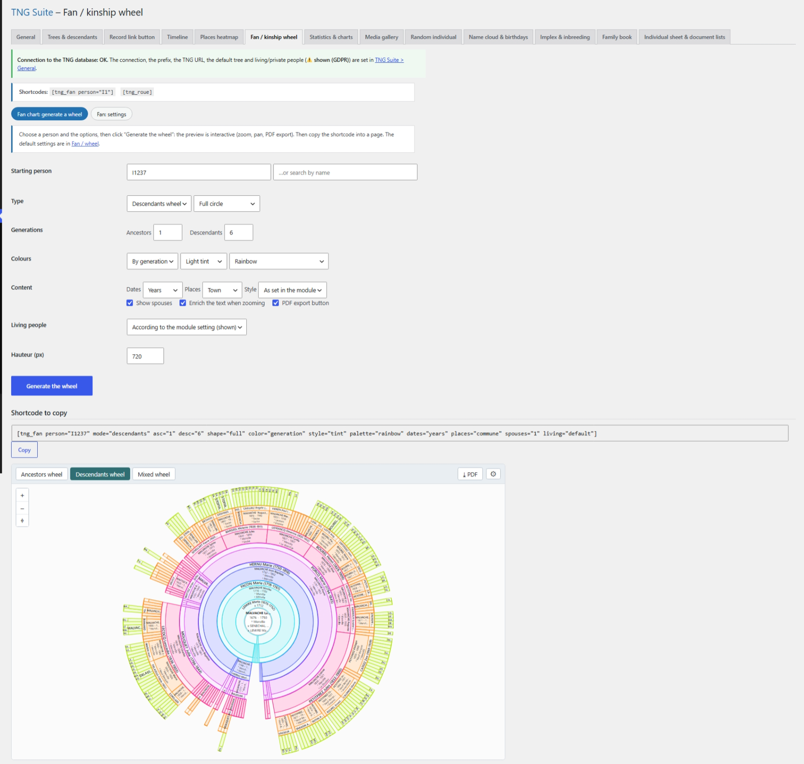

# Éventail / roue de parenté

Roue d’ascendants, de descendants ou mixte, interactive (zoom, déplacement, export PDF). La page comporte deux sections : Générer une roue et Réglages.

## Dans l’administration



## Shortcodes

```
[tng_fan person="I1" mode="descendants" asc="1" desc="6" shape="full" color="generation" style="tint" palette="rainbow" dates="years" places="commune" spouses="1" living="default" height="720"]
```

```
[tng_roue]
```

## Utilisation

1. Section « Générer une roue » : choisissez la personne, le type, les générations, les couleurs et le contenu, puis cliquez sur Générer la roue.
2. Vérifiez l’aperçu, puis copiez le shortcode affiché sous le bouton.
3. Collez-le dans une page. Les valeurs par défaut se règlent dans la section Réglages.

## Remarques

- living="show" ne fonctionne pas si « Toujours masquer » est choisi dans Général.

---
[← Guide des modules](README.md)
