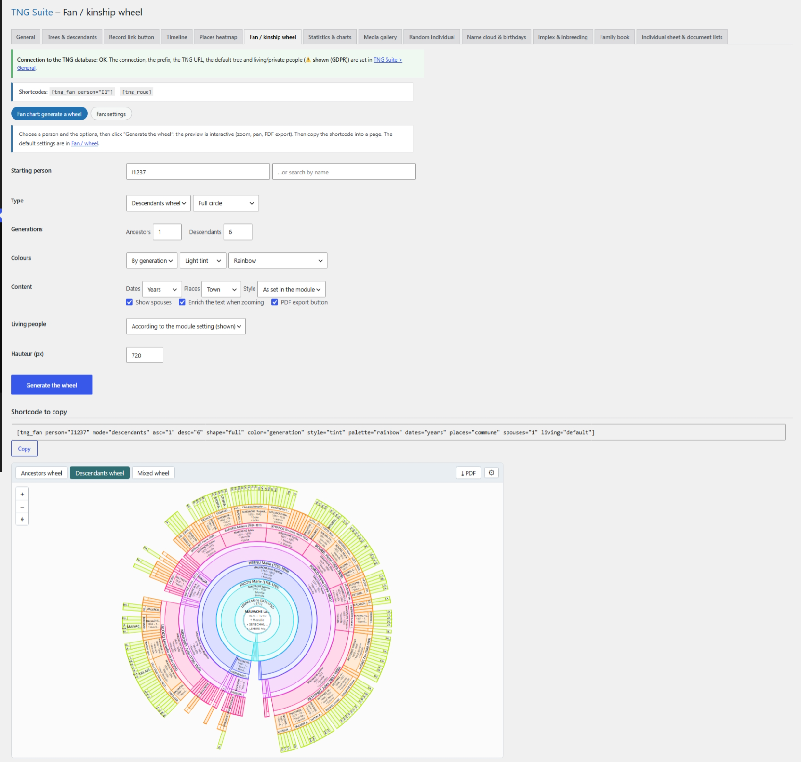

# Éventail / roue de parenté

Roue d’ascendants, de descendants ou mixte, interactive (zoom, déplacement, export PDF ou PNG). La page comporte deux sections : **Générer une roue** (aperçu + shortcode à copier) et **Réglages** (valeurs par défaut).

## Dans l’administration

Menu **TNG Suite > Arbres & visualisations**, sections **Éventail : générer une roue** et **Éventail : réglages**.



## Réglages du module

| Réglage | Effet |
|---|---|
| Personne de départ par défaut | Identifiant TNG utilisé quand `person` n’est pas indiqué. |
| Type / Générations | Ascendants, descendants ou mixte ; nombre de générations (ascendants jusqu’à 12, descendants jusqu’au plafond réglé). |
| Forme / Hauteur | Cercle complet, trois quarts ou demi-cercle ; hauteur en pixels. |
| Coloration / Style / Palette | Par génération, par branche ou par sexe ; teinte légère ou plein ; palette (Arc-en-ciel, Classique, Pastel, Vive, Daltonien, Camaïeu de bleus, Terre, Gris) ou palette personnalisée. |
| Contenu : dates, lieux, prénoms, style des textes, conjoints, zoom, ancêtres inconnus | Années / dates complètes / aucune ; lieux (aucun, commune, complet) ; premier prénom ou tous ; symboles (° †) ou lettres (N : D : M :) ; affichage des conjoints ; texte qui s’enrichit au zoom ; cases vides pour les ancêtres inconnus. |
| Qui peut voir le graphique | Tout le monde, utilisateurs connectés ou administrateurs. |
| Cache (minutes) | Durée de mise en cache des données de la roue (30 par défaut). |

## Shortcodes

```
[tng_fan person="I1" asc="6"]
```

Roue d’ascendants sur 6 générations.

```
[tng_fan person="I1" mode="mixed" asc="4" desc="3" shape="half"]
```

Roue mixte en demi-cercle.

```
[tng_roue person="I1"]
```

Alias français de `[tng_fan]`.

### Attributs

| Attribut | Valeurs | Défaut | Rôle |
|---|---|---|---|
| person | I1 | réglage | Personne de départ (obligatoire si aucune valeur par défaut). |
| tree | identifiant d’arbre | Général | Arbre (gedcom). |
| mode | ancestors, descendants, mixed | réglage | Type de roue. |
| asc / desc | 1–12 / 1–plafond | réglage | Générations d’ascendants / de descendants. |
| shape | full, three, half | réglage | Cercle complet, trois quarts, demi-cercle. |
| color | generation, branch, sex | réglage | Mode de coloration. |
| style | tint, solid | réglage | Teinte légère ou couleur pleine. |
| palette | id de palette ou `custom` | réglage | Palette de couleurs. |
| colors | `#aabbcc,#112233…` | (vide) | Couleurs imposées (jusqu’à 12), prioritaires sur la palette. |
| dates | years, full, none | réglage | Format des dates. |
| places | none, commune, full | réglage | Lieux affichés. |
| spouses | 1 / 0 | réglage | Afficher les conjoints. |
| living | default, hide, show | default | `hide` masque les vivants ; `show` les affiche seulement si Général l’autorise. |
| zoomdetail | 1 / 0 | réglage | Texte enrichi au zoom. |
| labels | symbols, letters | réglage | Symboles (° †) ou lettres. |
| pdf | 1 / 0 | 1 | Bouton d’export (PDF ou PNG). |
| controls | 1 / 0 | 1 | Boutons de zoom / navigation. |
| height | pixels | réglage | Hauteur de la roue. |
| class | classe CSS | (vide) | Classe CSS ajoutée au conteneur. |

## Utilisation

1. Section « Générer une roue » : choisissez la personne, le type, les générations, les couleurs et le contenu, puis cliquez sur **Générer la roue**.
2. Vérifiez l’aperçu, puis copiez le shortcode affiché sous le bouton.
3. Collez-le dans une page. Les valeurs par défaut se règlent dans la section Réglages.

## Remarques

- Export : le bouton **Exporter en PDF ou en PNG** ouvre une boîte de dialogue avec le **format de sortie** (PDF vectoriel ou PNG), le format de la feuille (adapté au texte, **taille maximale**, automatique, A4 à A0), l’orientation et le contenu (**complet** par défaut : dates et lieux complets ; ou selon les réglages du graphique). Le texte de chaque case est réduit pour tenir, jusqu’à 0,4 pt : dans les générations extérieures, très étroites, il est complet mais minuscule, à lire en zoomant dans le **PDF** (vectoriel, zoom sans limite). La boîte indique combien de cases ont un texte lisible (4 pt ou plus). Un PNG, limité en pixels, ne peut pas montrer ce détail : préférez le PDF pour une grande roue. Le **PNG** est une image : résolution au choix (150, 200 — recommandé — ou 300 dpi) et fond blanc ou **transparent** (case à cocher). Si la taille demandée dépasse la limite d’image du navigateur, la résolution est réduite automatiquement et le message l’indique. Le PNG est généré dans le navigateur : rien n’est envoyé au serveur.
- `living="show"` n’a aucun effet si « Toujours masquer » est choisi dans **Général**.
- Si l’accès est limité (connectés / administrateurs), les autres visiteurs voient un message à la place du graphique.
- Les résultats sont mis en cache ; après une modification dans TNG, utilisez **Général > Maintenance > Vider les caches** pour les voir tout de suite.

---
[← Guide des modules](README.md)
