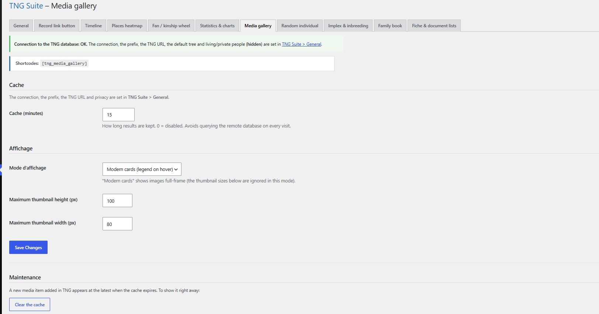

# Galerie de médias

Galerie des photos et médias de l’arbre, avec agrandissement (GLightbox), par personne ou par nom de famille.

## Dans l’administration

Menu **TNG Suite > Médias & widgets**, section **Galerie de médias**.



## Réglages du module

| Réglage | Effet |
|---|---|
| Cache (minutes) | Durée de mise en cache de la liste des médias. |
| Mode d’affichage | Grille standard, Masonry (Pinterest) ou Galerie élégante. |
| Hauteur / largeur max. des vignettes (px) | Taille des vignettes. |
| Maintenance | Bouton pour vider le cache : un média ajouté dans TNG apparaît sinon à l’expiration du cache. |

## Shortcodes

```
[tng_media_gallery]
```

Les 30 derniers médias.

```
[tng_media_gallery limit="60" surname="MARTIN"]
```

60 médias des personnes de nom MARTIN.

```
[tng_media_gallery personid="I12"]
```

Médias d’une personne.

### Attributs

| Attribut | Valeurs | Défaut | Rôle |
|---|---|---|---|
| limit | 1 – 100 | 30 | Nombre maximum de médias. |
| personid | I12 | {'fr': '(vide)', 'en': '(empty)'} | Limiter à une personne. |
| surname | {'fr': 'nom', 'en': 'name'} | {'fr': '(vide)', 'en': '(empty)'} | Limiter à un nom de famille. |

## Utilisation

1. Réglez l’affichage et le cache dans la section du module.
2. Collez le shortcode dans une page.

## Résultat sur le site


## Remarques

- Les médias de personnes vivantes ou privées sont exclus selon **Général > Modules**.
- Les administrateurs voient le détail d’une erreur de connexion ; les visiteurs ne voient rien.
- GLightbox est chargé depuis un CDN, sauf copie locale dans `libs/`.

---
[← Guide des modules](README.md)
