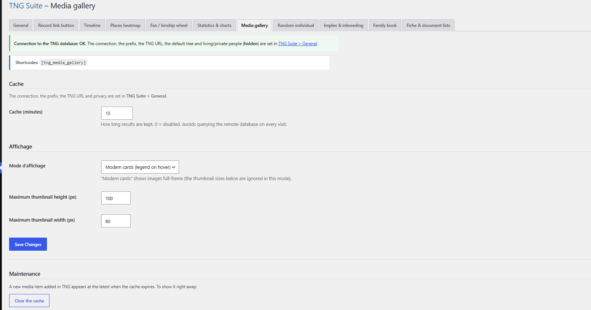

# Galerie de médias

Galerie des photos et médias de l’arbre.

## Dans l’administration



## Shortcodes

```
[tng_media_gallery]
```

## Utilisation

1. Réglez l’affichage sur la page du module.
2. Collez le shortcode dans une page.

## Résultat sur le site


---
[← Guide des modules](README.md)
