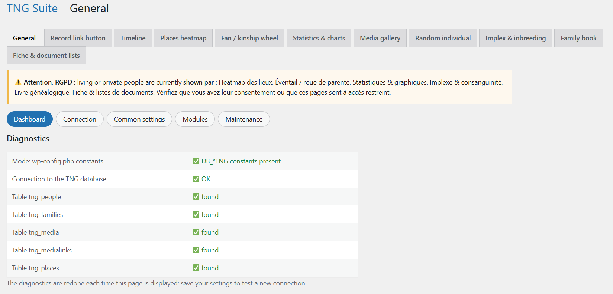

# Général

Page de départ : elle règle tout ce qui est commun aux modules.

## Dans l’administration

## Utilisation

1. Renseignez la connexion à la base de données TNG (hôte, base, utilisateur, mot de passe) et le préfixe des tables.
2. Indiquez l’URL de TNG et l’arbre (gedcom) par défaut.
3. Choisissez la langue de l’interface et des textes publics (français ou anglais).
4. Pour chaque module, décidez si les personnes vivantes ou privées sont masquées (recommandé, RGPD) ou affichées.
5. Activez ou désactivez les modules dans la section Modules.

## Remarques

- Les pages des modules se règlent chacune sur leur page ; la connexion n’est jamais à ressaisir.

---
[← Guide des modules](README.md)
