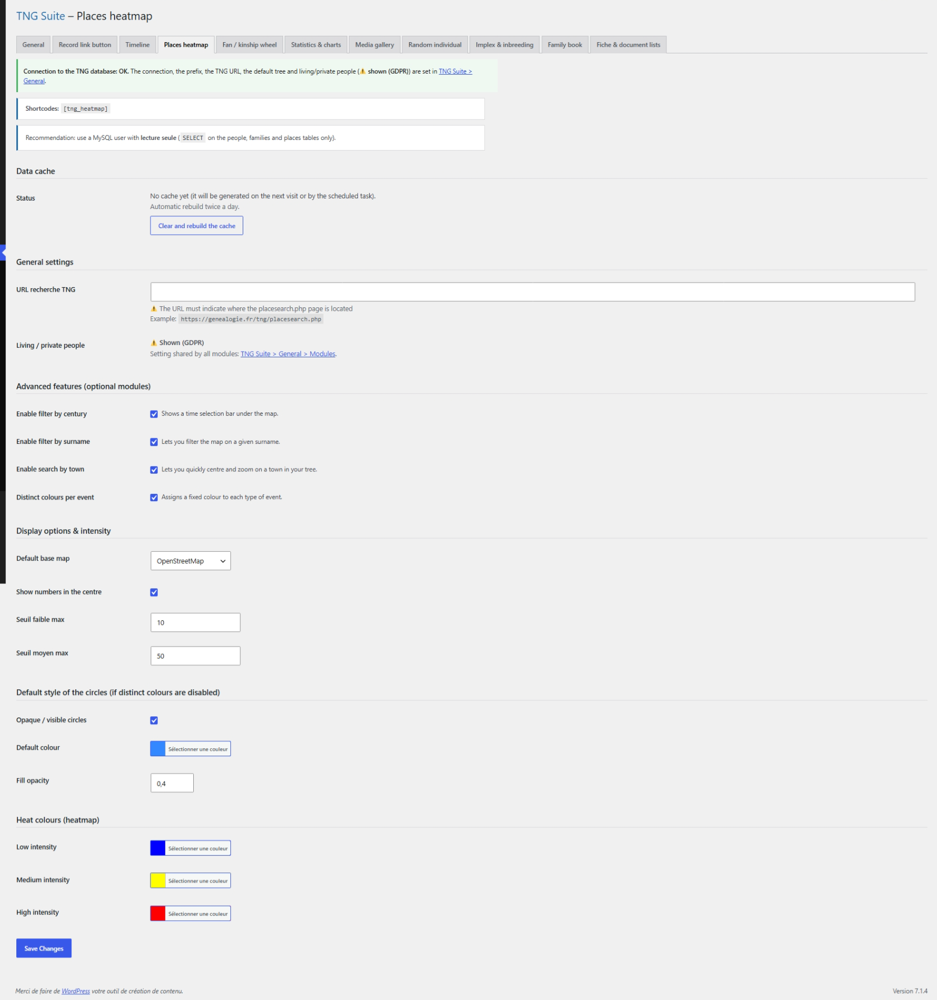

# Heatmap des lieux

Carte de chaleur des lieux de naissance, mariage, décès… de l’arbre.

## Dans l’administration



## Shortcodes

```
[tng_heatmap]
```

## Utilisation

1. Choisissez les événements pris en compte et le rendu de la carte sur la page du module.
2. Collez le shortcode dans une page.

## Résultat sur le site


## Remarques

- Fond de carte : 8 choix, tous gratuits et sans clé d’API ni inscription (OpenStreetMap, OpenStreetMap France, OpenTopoMap, Esri). Esri Gris clair est le plus sobre pour lire les couleurs de la heatmap ; Esri Rues et OpenStreetMap France sont les plus lisibles pour les noms de lieux.
- Les lieux doivent avoir des coordonnées dans TNG.

---
[← Guide des modules](README.md)
