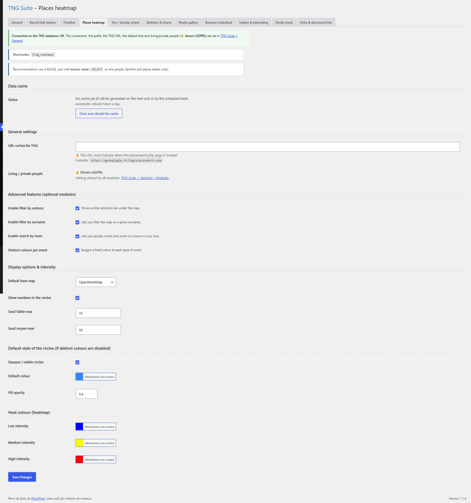

# Heatmap des lieux

Carte de chaleur des lieux de naissance, mariage, décès… de l’arbre.

## Dans l’administration

Menu **TNG Suite > Analyses > Heatmap des lieux**.




## Shortcodes

```
[tng_heatmap]
```

## Utilisation

1. Choisissez les événements pris en compte et le rendu de la carte sur la page du module.
2. Collez le shortcode dans une page.

## Résultat sur le site


## Remarques

- Fond de carte : 8 choix, tous gratuits et sans clé d’API ni inscription (OpenStreetMap, OpenStreetMap France, OpenTopoMap, Esri). Esri Gris clair est le plus sobre pour lire les couleurs de la heatmap ; Esri Rues et OpenStreetMap France sont les plus lisibles pour les noms de lieux.
- Couleurs de la chaleur : par défaut orange clair (faible), orange foncé (moyenne) et rouge sombre (forte), modifiables dans les réglages du module ; le bouton **Revenir à la palette recommandée** les rétablit. L’échelle est automatique (logarithmique) : les lieux à peu d’événements restent bien visibles, et seul le plus gros foyer de la sélection affichée (filtres compris) atteint la couleur forte.
- Chiffres au centre des ronds (option « Afficher les chiffres au centre ») : ils n’apparaissent qu’à partir de l’échelle d’une région (zoom 8) et sans se chevaucher : les plus gros nombres sont posés d’abord, un chiffre qui en recouvrirait un autre est omis jusqu’au zoom suivant ; le nombre est toujours visible dans l’infobulle au survol.
- Les lieux doivent avoir des coordonnées dans TNG.

---
[← Guide des modules](README.md)
