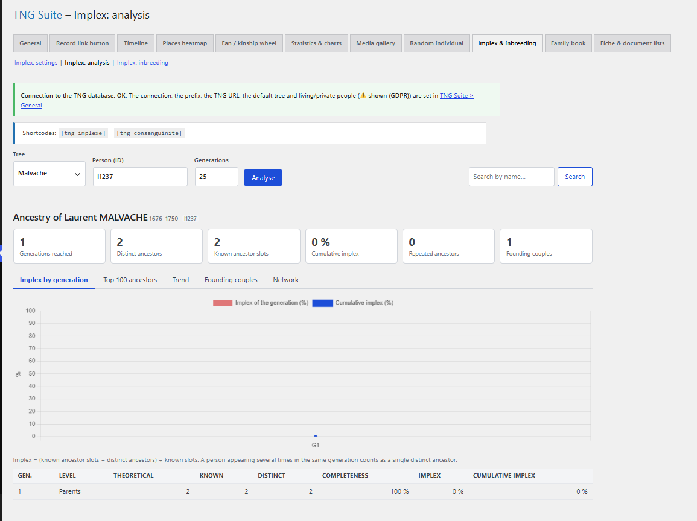

# Implexe & consanguinité

Analyse de l’implexe (ancêtres répétés) et de la consanguinité. Trois sections : Analyse, Consanguinité, Réglages.

## Dans l’administration



## Shortcodes

```
[tng_implexe]
```

```
[tng_consanguinite tree="monarbre" per_page="50"]
```

## Utilisation

1. Section Analyse : choisissez l’arbre, la personne et le nombre de générations, puis Analyser (graphiques, ancêtres les plus fréquents, couples fondateurs, réseau).
2. Section Consanguinité : lancez le calcul pour classer les personnes.
3. Section Réglages : options d’affichage public.

## Remarques

- L’implexe = (places d’ancêtres connues − ancêtres distincts) ÷ places connues.

---
[← Guide des modules](README.md)
