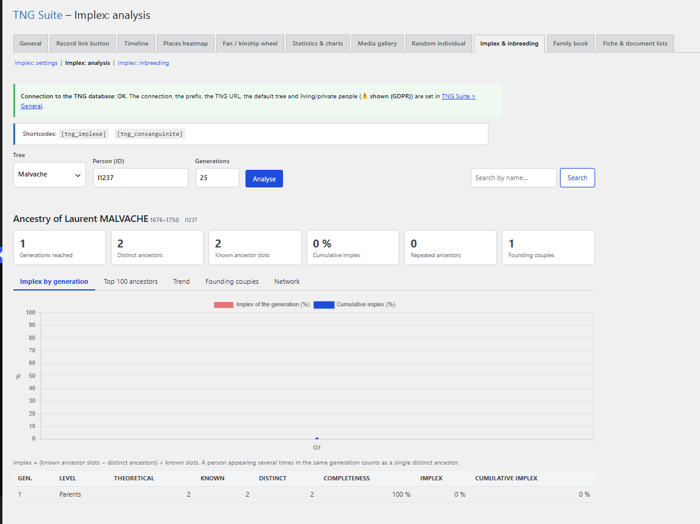

# Implexe & consanguinité

Analyse de l’implexe (ancêtres qui apparaissent plusieurs fois) et de la consanguinité. Trois sections : **Analyse**, **Consanguinité** et **Réglages**. Chart.js et vis-network sont chargés depuis un CDN, sauf copie locale.

## Dans l’administration

Menu **TNG Suite > Analyses**, sections **Implexe : analyse**, **Implexe : consanguinité** et **Implexe : réglages**.



## Réglages du module

| Réglage | Effet |
|---|---|
| Personne de départ par défaut | Identifiant TNG utilisé quand `person` n’est pas indiqué. |
| Générations maximum | Plafond du nombre de générations analysées (25 par défaut). |
| Générations du réseau | Profondeur du graphe en réseau (6 par défaut, 10 au plus). |
| Qui peut voir les résultats (shortcode) | Tout le monde, utilisateurs connectés (défaut) ou administrateurs. |
| Cache (minutes) | Durée de mise en cache des analyses (60 par défaut). |

## Shortcodes

```
[tng_implexe person="I1" generations="12"]
```

Analyse de l’implexe : graphiques, ancêtres les plus fréquents, couples fondateurs, réseau.

```
[tng_consanguinite per_page="50"]
```

Classement des personnes par coefficient de consanguinité (calcul fait par un administrateur, résultats stockés dans la table `tngi_inbreeding`).

### `[tng_implexe]`

| Attribut | Valeurs | Défaut | Rôle |
|---|---|---|---|
| tree | {'fr': 'identifiant d’arbre', 'en': 'tree ID'} | {'fr': 'réglage Général', 'en': 'General setting'} | Arbre (gedcom). |
| person | I1 | {'fr': 'réglage', 'en': 'setting'} | Personne de départ. |
| generations | 2 – max | {'fr': 'maximum du réglage', 'en': 'setting maximum'} | Générations analysées. |
| network_generations | 2 – 10 | {'fr': 'réglage', 'en': 'setting'} | Générations du réseau. |

### `[tng_consanguinite]`

| Attribut | Valeurs | Défaut | Rôle |
|---|---|---|---|
| tree | {'fr': 'identifiant d’arbre', 'en': 'tree ID'} | {'fr': 'réglage Général', 'en': 'General setting'} | Arbre (gedcom). |
| per_page | 10 – 100 | 50 | Lignes par page. |

## Utilisation

1. Section Analyse : choisissez l’arbre, la personne et le nombre de générations, puis **Analyser**.
2. Section Consanguinité : lancez le calcul (par lots) pour classer les personnes.
3. Section Réglages : valeurs par défaut, accès et cache ; puis collez les shortcodes dans une page.

## Remarques

- Implexe = (places d’ancêtres connues − ancêtres distincts) ÷ places connues.
- Les analyses publiques passent par l’API REST du plugin et respectent le réglage « Qui peut voir » ; le calcul de consanguinité est réservé aux administrateurs.
- La table `tngi_inbreeding` est créée dans la base WordPress et supprimée à la désinstallation du plugin.
- Les personnes vivantes ou privées suivent le réglage de **Général > Modules** (masquées par défaut, recommandé pour le RGPD).

---
[← Guide des modules](README.md)
