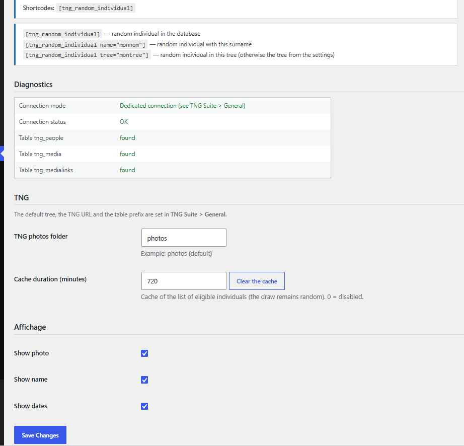

# Individu au hasard

Affiche une personne tirée au hasard (avec photo, nom et dates) ou limitée à un nom de famille. Activé et protégé (vivants / privés) avec le module Nuage de noms & anniversaires : masqué par défaut.

## Dans l’administration

Menu **TNG Suite > Médias & widgets**, section **Individu au hasard**.



## Réglages du module

| Réglage | Effet |
|---|---|
| Répertoire des photos TNG | Dossier des photos TNG (défaut : `photos`). |
| Durée du cache (minutes) | Durée de mémorisation de la liste des personnes candidates. |
| Afficher photo / nom et prénom / dates | Éléments affichés sur la carte. |
| Silhouette sans photo | Portrait (cercle sur fond clair) ou Rond (sans fond), quand la personne n’a pas de photo. |

## Shortcodes

```
[tng_random_individual]
```

Une personne au hasard dans l’arbre par défaut.

```
[tng_random_individual name="MARTIN" tree="monarbre"]
```

Tirage limité à un nom de famille et à un arbre.

### Attributs

| Attribut | Valeurs | Défaut | Rôle |
|---|---|---|---|
| name | {'fr': 'nom de famille', 'en': 'surname'} | {'fr': '(vide : tous)', 'en': '(empty: all)'} | Limite le tirage à ce nom. |
| tree | {'fr': 'identifiant d’arbre', 'en': 'tree ID'} | {'fr': 'arbre de Général', 'en': 'tree from General'} | Arbre (gedcom). |

## Utilisation

1. Réglez le contenu affiché (photo, nom, dates) et le répertoire des photos.
2. Collez le shortcode ; `name` limite le tirage à un nom de famille.

## Résultat sur le site


## Remarques

- Les personnes vivantes ou privées suivent le réglage de **Général > Modules** (masquées par défaut, recommandé pour le RGPD). Pour ce module, la valeur par défaut est « Toujours masquer ».
- Un message générique (« Contenu momentanément indisponible ») s’affiche aux visiteurs si la base est injoignable ; le détail n’est visible que par les administrateurs.
- Les résultats sont mis en cache ; après une modification dans TNG, utilisez **Général > Maintenance > Vider les caches** pour les voir tout de suite.

---
[← Guide des modules](README.md)
