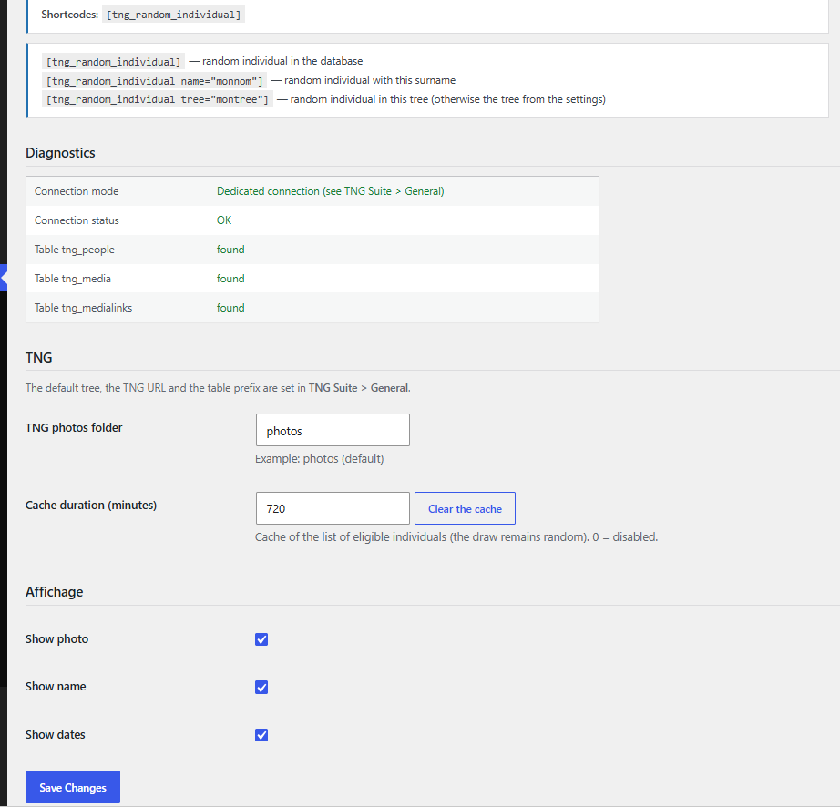

# Individu au hasard

Affiche une personne tirée au hasard (ou un nom précis).

## Dans l’administration



## Shortcodes

```
[tng_random_individual]
```

```
[tng_random_individual name="MARTIN"]
```

## Utilisation

1. Réglez le contenu affiché sur la page du module.
2. Collez le shortcode ; name limite le tirage à un nom de famille, tree à un arbre.

## Résultat sur le site


---
[← Guide des modules](README.md)
