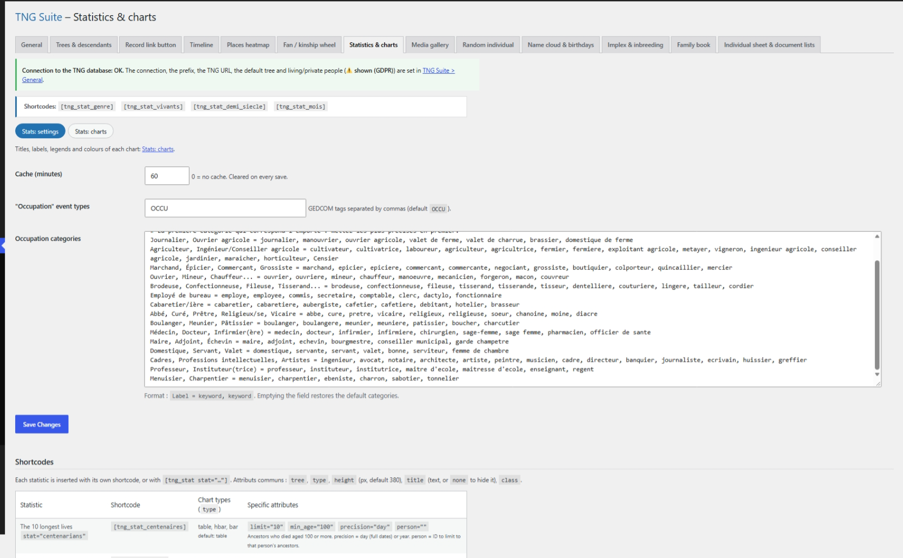

# Statistiques & graphiques

Graphiques publics (sexe, vivants, demi-siècles, mois…). Deux sections : Réglages et Graphiques (titre, libellés, couleurs de chaque graphique).

## Dans l’administration



## Shortcodes

```
[tng_stat_genre]
```

```
[tng_stat_vivants]
```

```
[tng_stat_demi_siecle]
```

```
[tng_stat_mois]
```

```
[tng_stat type="…" height="380"]
```

## Utilisation

1. Section Réglages : options générales des statistiques.
2. Section Graphiques : renommez titres, libellés et couleurs de chaque graphique.
3. Collez le shortcode du graphique voulu dans une page.

## Résultat sur le site


## Remarques

- Seuls des totaux sont publiés.

---
[← Guide des modules](README.md)
