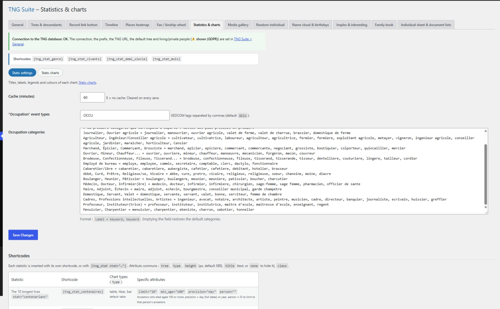

# Statistiques & graphiques

Graphiques publics construits à partir de la base TNG : genre, vivants, naissances et décès par demi-siècle ou par mois, espérance de vie, pyramide des âges, âge à l’union, distance moyenne, villes, métiers, plus longues vies. Seuls des **totaux** sont publiés. Chart.js est chargé depuis un CDN, sauf copie locale dans `libs/`.

## Dans l’administration

Menu **TNG Suite > Analyses**, sections **Stats : réglages** et **Stats : graphiques**.



## Réglages du module

**Section Réglages**

| Réglage | Effet |
|---|---|
| Cache (minutes) | Durée de mise en cache des résultats de chaque graphique. |
| Types d’événement « profession » | Types d’événement TNG qui contiennent le métier (pour le graphique des métiers). |
| Catégories de métiers | Regroupez les professions : un intitulé et les mentions qui le composent (une catégorie par ligne). |
| Professions non classées | Liste des mentions trouvées qui ne correspondent à aucune catégorie, pour compléter vos catégories. |
| Section Graphiques : palette | Palette par défaut de tous les graphiques (palettes prédéfinies ou « Ma palette personnalisée »). |
| Section Graphiques : pour chaque graphique | Titre, type de graphique, libellés (légende, tableau), titres des axes, légende, note sous le graphique et couleurs. |

## Shortcodes

Un shortcode par statistique, plus le shortcode générique `[tng_stat stat="…"]` (la valeur de `stat` est la clé de la première colonne).

```
[tng_stat_genre]
```

Répartition hommes / femmes / inconnus.

```
[tng_stat_esperance min_age="5" min_n="5"]
```

Espérance de vie par siècle, en écartant la mortalité infantile.

```
[tng_stat_pyramide year="1850" step="10"]
```

Pyramide des âges des personnes vivantes en 1850.

```
[tng_stat_villes limit="15" source="birth,death" type="hbar"]
```

Les 15 premières villes de naissance et de décès.

```
[tng_stat stat="gender" type="doughnut" height="320"]
```

Forme générique : `stat` = clé de la statistique, `type` = type de graphique.

### Attributs communs à tous les graphiques

| Attribut | Valeurs | Défaut | Rôle |
|---|---|---|---|
| type | selon la statistique (voir ci-dessous) | 1er type de la liste | Type de graphique : `pie`, `doughnut`, `polarArea`, `bar`, `hbar`, `line`, `area`, `radar`, `pyramid` ou `table`. |
| tree | identifiant d’arbre | arbre de Général | Arbre (gedcom). |
| height | pixels | 380 | Hauteur du graphique. |
| title | texte | titre du réglage | Remplace le titre. |
| class | classe CSS | (vide) | Classe CSS ajoutée au conteneur. |

### Statistiques disponibles

| Attribut | Valeurs | Défaut | Rôle |
|---|---|---|---|
| centenarians — `[tng_stat_centenaires]` | table, hbar, bar | table | Les plus longues vies. `limit` (10), `min_age` (100), `precision` (`day` ou `year`), `person` (limiter aux ancêtres d’une personne). |
| gender — `[tng_stat_genre]` | pie, doughnut, polarArea, bar, hbar, table | doughnut | Hommes, femmes, inconnus (vivants inclus). |
| living — `[tng_stat_vivants]` | idem | polarArea | Nombre de personnes décédées et vivantes (totaux seulement). Les libellés se renomment dans Stats : graphiques. |
| marriage_age — `[tng_stat_age_union]` | line, area, bar, table | line | Âge moyen à la première union (H/F) par siècle. `min_n` (3) : cas minimum par siècle et sexe. |
| life_expectancy — `[tng_stat_esperance]` | line, area, bar, table | line | Âge moyen au décès par siècle du décès. `min_age` (0 ; 5 ou 20 pour écarter la mortalité infantile), `min_n` (5). |
| pyramid — `[tng_stat_pyramide]` | pyramid, bar, table | pyramid | Sans `year` : âges au décès (hommes à gauche, femmes à droite). Avec `year="1850"` : âges des personnes vivantes cette année-là. `step` (10 ; 5 ou 10), `max_age` (100). |
| distance — `[tng_stat_distance]` | line, area, bar, hbar, table | line | Distance moyenne en km entre naissance et décès (lieux géolocalisés requis). `from` (1650), `to` (2024), `step` (75), `basis` (`death` ou `birth`). |
| half_century — `[tng_stat_demi_siecle]` | bar, line, area, table | bar | Naissances et décès par période. `from` (1200), `to` (2000), `step` (50 ; 25, 100…). |
| months — `[tng_stat_mois]` | area, line, bar, radar, table | area | Naissances et décès par mois. |
| places — `[tng_stat_villes]` | hbar, bar, pie, doughnut, polarArea, table | hbar | Principales villes. `limit` (20), `level` (1 = avant la première virgule), `source` (`birth,baptism,marriage,death,burial` ou `all`), `others` (1 pour ajouter « Autres »). |
| occupations — `[tng_stat_metiers]` | pie, doughnut, polarArea, bar, hbar, table | pie | Principaux métiers en %. `limit` (15), `others` (0 ; 1 pour afficher les professions non classées). Voir les réglages « profession » ci-dessus. |

## Utilisation

1. Section Réglages : cache, types d’événement « profession » et catégories de métiers.
2. Section Graphiques : palette, titres, libellés et couleurs de chaque graphique.
3. Collez le shortcode du graphique voulu dans une page.

## Résultat sur le site


## Remarques

- Seuls des totaux sont publiés (aucun nom).
- Si un type n’est pas autorisé pour la statistique, le type par défaut est utilisé.
- Les résultats sont mis en cache ; après une modification dans TNG, utilisez **Général > Maintenance > Vider les caches** pour les voir tout de suite.

---
[← Guide des modules](README.md)
