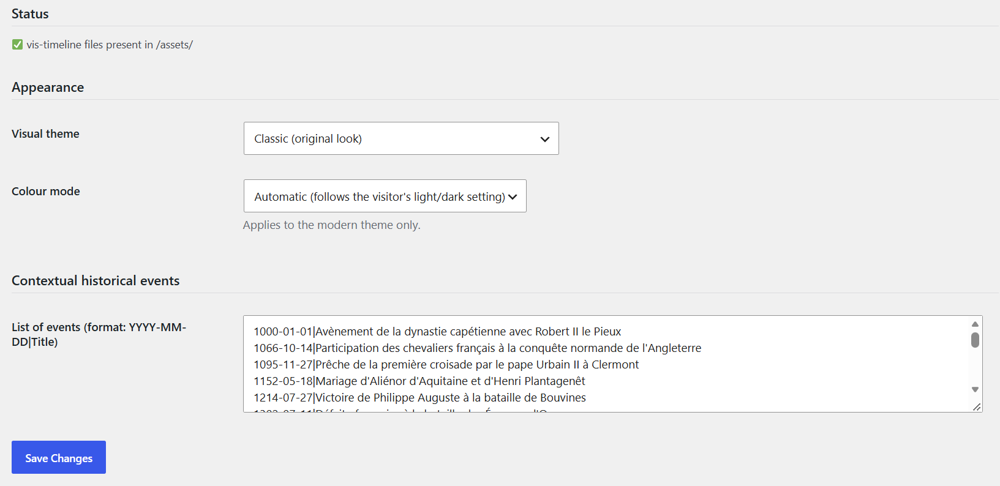

# Frise chronologique

Frise chronologique des événements d’une personne ou d’une famille.

## Dans l’administration



## Shortcodes

```
[tng_timeline person="I1"]
```

```
[tng_timeline family="F1"]
```

## Utilisation

1. Choisissez l’apparence et les types d’événements sur la page du module.
2. Collez le shortcode avec person (ou family) et, si besoin, tree.

## Résultat sur le site


---
[← Guide des modules](README.md)
