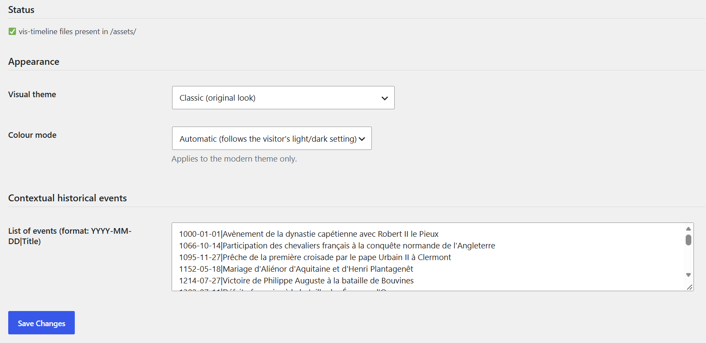

# Frise chronologique

Frise interactive des événements d’une personne ou d’une famille (naissance, baptême, mariage, enfants, décès…), avec en option des événements historiques en arrière-plan. La bibliothèque vis-timeline est incluse dans le plugin (aucun chargement externe).

## Dans l’administration

Menu **TNG Suite > Arbres & visualisations**, section **Frise chronologique**.



## Réglages du module

| Réglage | Effet |
|---|---|
| Thème visuel | Classique (apparence d’origine) ou Moderne (carte arrondie, ombres douces, accents colorés). |
| Mode de couleurs | Automatique (suit le réglage clair / sombre du visiteur), toujours clair ou toujours sombre. |
| Masquer les personnes vivantes ou privées | S’applique au thème moderne ; la valeur est reprise de Général > Modules. |
| Liste des événements historiques | Un événement par ligne, au format `AAAA-MM-JJ\|Titre` (ex. `1789-07-14\|Prise de la Bastille`). Ils s’affichent en arrière-plan de toutes les frises. |

## Shortcodes

```
[tng_timeline person="I1"]
```

Frise d’une personne.

```
[tng_timeline family="F12" tree="monarbre"]
```

Frise d’une famille (couple et enfants).

### Attributs

| Attribut | Valeurs | Défaut | Rôle |
|---|---|---|---|
| person | I1 | (vide) | Identifiant de la personne. `person` ou `family` est obligatoire. |
| family | F12 | (vide) | Identifiant de la famille. |
| tree | identifiant d’arbre | arbre de Général | Arbre (gedcom). |

## Utilisation

1. Choisissez le thème et le mode de couleurs, ajoutez éventuellement des événements historiques.
2. Collez le shortcode avec `person` (ou `family`) et, si besoin, `tree`.

## Résultat sur le site


## Remarques

- Les personnes vivantes ou privées suivent le réglage de **Général > Modules** (masquées par défaut, recommandé pour le RGPD).
- Les résultats sont mis en cache ; après une modification dans TNG, utilisez **Général > Maintenance > Vider les caches** pour les voir tout de suite.
- Sans `person` ni `family`, un message d’aide s’affiche à la place de la frise.

---
[← Guide des modules](README.md)
