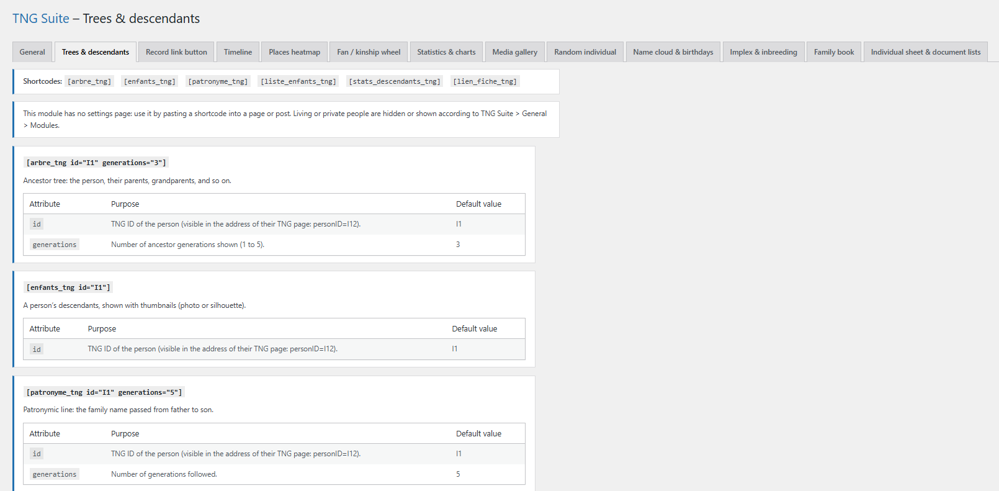

# Arbres & descendance

Arbres d’ascendance, descendants avec vignettes, lignée patronymique, listes et liens vers la fiche TNG. Ce module n’a pas de réglages propres : la page d’administration est une aide qui liste chaque shortcode, ses attributs et un exemple. La connexion, le préfixe et la confidentialité se règlent dans **Général**.

## Dans l’administration

Menu **TNG Suite > Arbres & visualisations**, section **Arbres & descendance**.



## Shortcodes

```
[arbre_tng id="I1" generations="3"]
```

Arbre d’ascendance : la personne, ses parents, grands-parents…

```
[enfants_tng id="I1"]
```

Descendants d’une personne, présentés avec leurs vignettes (photo ou silhouette).

```
[patronyme_tng id="I1" generations="5"]
```

Lignée patronymique : la transmission du nom de père en fils.

```
[liste_enfants_tng id="F12"]
```

Liste des enfants d’une **famille** (couple) : l’`id` est un identifiant de famille (F12…), obligatoire.

```
[stats_descendants_tng id="I1"]
```

Statistiques de descendance : nombre de descendants à chaque génération.

```
[lien_fiche_tng id="I1"]
```

Bouton qui renvoie vers la fiche TNG de la personne (voir aussi le module « Bouton vers la fiche », plus personnalisable).

### Attributs

| Attribut | Valeurs | Défaut | Rôle |
|---|---|---|---|
| id | I1, I25… | I1 | Identifiant TNG de la personne (`personID=I12` dans l’adresse de sa page) ; pour `liste_enfants_tng`, identifiant de la famille (F12). |
| generations | {'fr': 'nombre entier', 'en': 'whole number'} | {'fr': '3 (arbre), 5 (patronyme)', 'en': '3 (tree), 5 (patronymic)'} | Nombre de générations. Plafond : 5 pour `arbre_tng`, 30 pour `patronyme_tng`, 15 niveaux pour les descendants. |

## Utilisation

1. Repérez l’identifiant TNG de la personne (`personID=I12` dans l’adresse de sa page).
2. Collez le shortcode dans une page ou un article, avec l’`id` voulu.
3. Publiez : l’arbre s’affiche et les liens mènent à la fiche TNG.

## Résultat sur le site


## Remarques

- Les personnes vivantes ou privées suivent le réglage de **Général > Modules** (masquées par défaut, recommandé pour le RGPD).
- Les résultats sont mis en cache ; après une modification dans TNG, utilisez **Général > Maintenance > Vider les caches** pour les voir tout de suite.
- Les limites de génération se règlent par code avec les filtres `tng_max_ancestor_generations`, `tng_max_patronymic_generations` et `tng_max_descendant_generations`.

---
[← Guide des modules](README.md)
