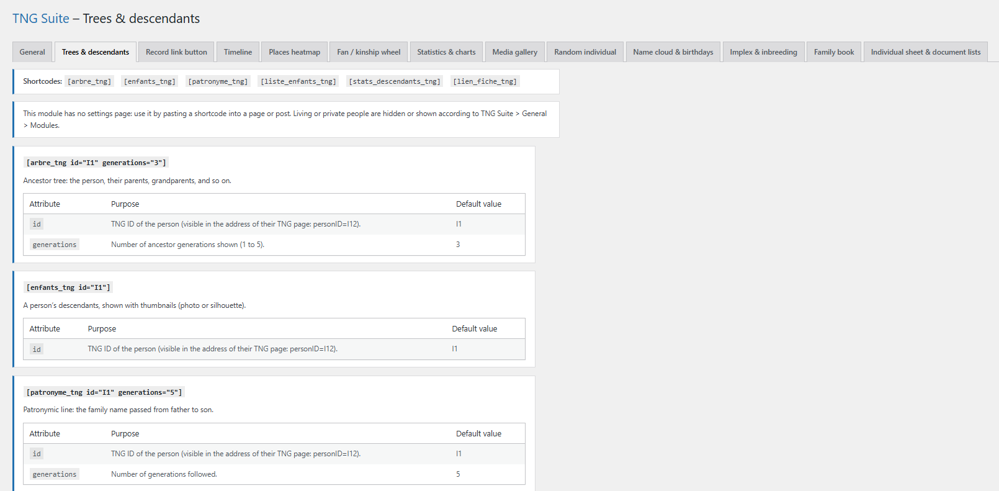

# Arbres & descendance

Arbres d’ascendance, descendants avec vignettes, lignée patronymique, listes et liens vers la fiche TNG. Ce module n’a pas de réglages : la page d’administration est une aide qui liste chaque shortcode, ses attributs et un exemple.

## Dans l’administration



## Shortcodes

```
[arbre_tng id="I1" generations="3"]
```

```
[enfants_tng id="I1"]
```

```
[patronyme_tng id="I1" generations="5"]
```

```
[liste_enfants_tng]
```

```
[stats_descendants_tng]
```

```
[lien_fiche_tng]
```

## Utilisation

1. Repérez l’identifiant TNG de la personne (dans l’adresse de sa page : personID=I12).
2. Collez le shortcode dans une page ou un article, avec l’id voulu.
3. Publiez : l’arbre s’affiche, les liens mènent à la fiche TNG.

## Résultat sur le site


## Remarques

- Les personnes vivantes ou privées suivent le réglage de Général > Modules.

---
[← Guide des modules](README.md)
